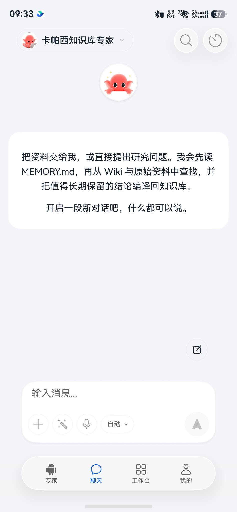
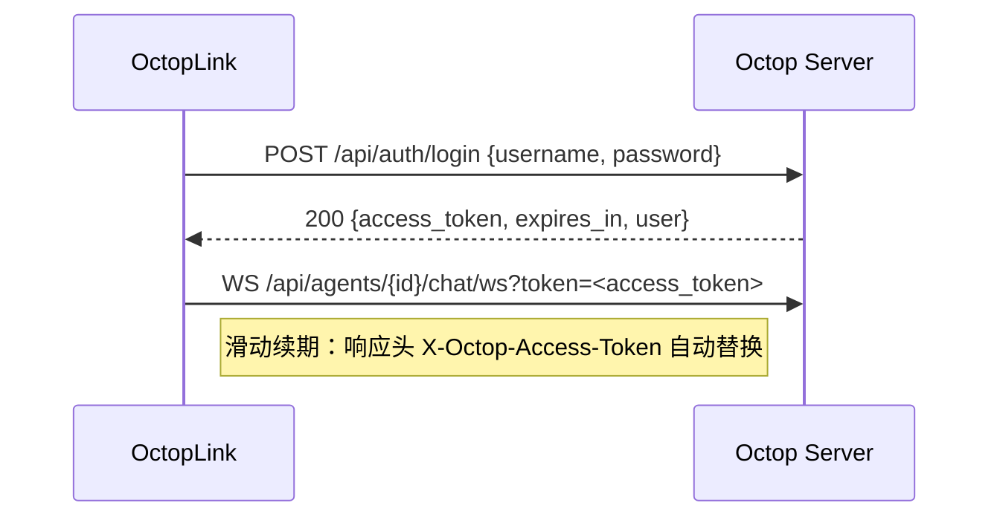

# OctopLink

<div align="center">


[](https://github.com/dwc13775953197-spec/OctopLink/releases)
[](https://github.com/dwc13775953197-spec/OctopLink)
[](https://github.com/dwc13775953197-spec/OctopLink/commits/master)

</div>

---

**OctopLink** 是基于 **HarmonyOS (ArkTS)** 开发的智能体对话客户端，完整对接 **TencentCloud Octop** 智能体平台，提供原生级的多智能体管理、流式对话、工作区协作、语音交互、记忆系统等能力。

> 📦 **最新版本**: [v1.0.0](https://github.com/dwc13775953197-spec/OctopLink/releases/tag/v1.0.0) — [下载签名安装包 `OctopLink-v1.0.0.hap`](https://github.com/dwc13775953197-spec/OctopLink/releases/download/v1.0.0/OctopLink-v1.0.0.hap)（8.0 MB）

---

## 📱 应用截图

以下为 OctopLink HarmonyOS 客户端的实际界面截图。

<table>
  <tr>
    <td align="center"><br><b>客户端界面 1</b></td>
    <td align="center"><br><b>客户端界面 2</b></td>
    <td align="center"><br><b>客户端界面 3</b></td>
  </tr>
  <tr>
    <td align="center"><br><b>客户端界面 4</b></td>
    <td align="center"><br><b>客户端界面 5</b></td>
    <td align="center"><br><b>客户端界面 6</b></td>
  </tr>
</table>

## ✨ 核心功能

### 💬 智能体对话
| 功能 | 说明 |
|------|------|
| **多智能体切换** | 支持个人/共享/专家智能体，Tab 页快速切换 |
| **流式对话** | SSE + WebSocket 双通道，毫秒级响应，支持打字机效果 |
| **HITL 交互** | Human-in-the-Loop：工具调用需用户确认，安全可控 |
| **消息历史** | 分页加载、导出轨迹、轨迹可视化（节点/边/时间轴） |
| **Markdown 渲染** | 代码高亮、数学公式、Mermaid 图表、表格、任务列表 |

### 🤖 智能体管理
- **全生命周期**：创建、编辑、删除、启停、重载、状态监控
- **共享与权限**：`is_shared` 公开只读、`is_owner` 所有者权限、Team 协作
- **专家发布**：一键发布为 Expert，支持版本管理、图标/欢迎语自定义
- **模板系统**：预置人设模板（MBTI、System Prompt、默认模型）

### 🗂 工作区
| 模块 | 核心能力 |
|------|----------|
| **文件系统** | 树形浏览、读写/删/移动、全局搜索、归档下载、媒体预览 |
| **知识库** | 文档上传/文本建档、向量索引、OCR 识别、ONNX 本地嵌入、重索引 |
| **技能/技能包** | 技能 CRUD、启用禁用、导入导出、SkillHub 搜索安装、包级管理 |
| **子代理** | 目录浏览、分类筛选、一键安装到智能体 |
| **定时任务** | Cron 表达式、Prompt 模板、新线程/续用线程、任务类型区分 |
| **连接器** | CLI 设备码授权、OAuth 待决、Custom MCP、Feishu 用户授权 |

### 🎙 语音与多媒体
- **STT**：多语言语音识别，支持流式上传
- **TTS**：云端/本地双引擎，语音选择、语速调节（0.5–2.0）、字数预裁剪
- **音频可视化**：波形/频谱实时渲染

### 🧠 记忆系统（五大分区）
1. **候选记忆** — 待审核池，通过/驳回/编辑
2. **强记忆** — 长期固化，优先检索
3. **用户记忆** — 个人偏好画像
4. **每日记忆** — 时间序列日志
5. **实体/事件/片段** — 结构化知识图谱

### 🌉 Bridge 远程能力
- 对端专家发现与连接
- 隧道探测、连接/断开、状态同步
- 远程调用本地工具、文件系统透传

### ⚙️ 系统与运维
- **SSO/OAuth/OIDC**：GitHub/Google/企业 IdP，邀请码注册兑换
- **管理员面板**：备份/恢复、存储后端切换、安全策略、环境变量、Langfuse 对接、TLS 证书、用量导出
- **用户体系**：角色/权限/组、批量操作、解锁/重置密码

### 🎨 UI 体验
- 沉浸式全屏（状态栏/导航栏融合）
- 三模外观：浅色 / 深色 / 跟随系统，动态状态栏色
- **桌面级宠物**：聊天头部 48×48vp，五心情（Working/Waiting/Happy/Error/Idle）派生自会话状态
- Command Palette（⌘K 全局搜索指令）
- 30+ 复用组件：CapsuleSegmentBar、StreamingOrbit、MarkdownText、MessageBubble…

---

## 🏗 技术架构

```
┌─────────────────────────────────────────────────────────────┐
│                        OctopLink                             │
├─────────────────────────────────────────────────────────────┤
│  Pages (Chat / Expert / Me / Workspace)                     │
├─────────────────────────────────────────────────────────────┤
│  Components │ Pet │ Store (Session/Appearance/AppPrefs)     │
├─────────────────────────────────────────────────────────────┤
│  Services (Agent/Thread/Workspace/Memory/Bridge/Voice/...)  │
├─────────────────────────────────────────────────────────────┤
│  Models (Agent/Thread/Message/Memory/Skill/Workspace/...)   │
├─────────────────────────────────────────────────────────────┤
│  Net: HttpClient (REST) │ SseClient (SSE) │ WsClient (WS)   │
├─────────────────────────────────────────────────────────────┤
│  HarmonyOS SDK 26 │ ArkTS │ Hvigor │ JWT Bearer Auth        │
└─────────────────────────────────────────────────────────────┘
```

**关键技术选型**
| 层级 | 方案 |
|------|------|
| 构建 | Hvigor + hvigor-ohos-plugin |
| 网络 | 原生 `http` + `webSocket` + SSE `EventSource` |
| 状态 | `@Observable` + `@StorageLink` + `AppStorage` |
| 导航 | `Navigation` + `NavPathStack` (Stage 模型) |
| 存储 | `preferences` (Key-Value) + `dataPreferences` |
| 签名 | Release 证书 (ECDSA-SHA256) |

---

## 📁 项目结构

```text
OctopLink/
├── AppScope/                      # 应用全局配置 (app.json5, resources)
├── entry/                         # 主模块 (HAP)
│   ├── src/main/ets/
│   │   ├── components/            # 30+ 复用组件
│   │   ├── entryability/          # EntryAbility / EntryBackupAbility
│   │   ├── model/                 # 28 个数据模型
│   │   ├── net/                   # HttpClient / SseClient / WsClient
│   │   ├── pages/
│   │   │   ├── chat/              # ChatHomeTab, ChatTab, ThreadSettings, Trajectory
│   │   │   ├── expert/            # ExpertList, ExpertCreate, AgentEdit, Teams
│   │   │   ├── me/                # MeTab, About, Admin, AdminOps, Help, Sso, Voice, Providers
│   │   │   └── workspace/         # 13 个工作区子页面
│   │   ├── pet/                   # PetAvatar, PetMood (5 心情状态机)
│   │   ├── service/               # 28 个业务服务
│   │   ├── store/                 # SessionStore, AppearanceStore, AppPrefs
│   │   └── utils/                 # JsonHelper, ParseWriteTodos, TextPacer...
│   │   └── src/main/resources/        # 媒体/颜色/字符串/原始文件
├── docs/                          # 文档
│   ├── api-contract.md            # API 契约 (源码级，424 paths)
│   ├── api-gap-audit.md           # 覆盖度审计 (58% REST, 0 drift)
│   └── pet-design.md              # 宠物设计文档
├── spec/                          # 迭代规格 (16 个 feature spec)
├── hvigorfile.ts                  # 构建脚本入口
├── build-profile.json5            # 产物/签名/混淆配置
├── oh-package.json5               # 依赖声明
└── README.md
```

---

## 🚀 快速开始

### 环境要求
| 工具 | 版本 |
|------|------|
| HarmonyOS SDK | 26.0.0 (API 26) |
| DevEco Studio | 5.0+ |
| Node.js | 18+ |
| Hvigor | 内置 (hvigorw) |

### 构建命令
```bash
# 1. 克隆仓库
git clone https://github.com/dwc13775953197-spec/OctopLink.git
cd OctopLink

# 2. 安装依赖 (ohpm)
ohpm install

# 3. 构建调试包 (未签名，可直接 hdc 安装)
./hvigorw assembleDebug

# 4. 构建发布包 (已签名，entry/build/default/outputs/default/)
./hvigorw assembleRelease
```

### 安装到设备
```bash
# 通过 hdc 安装 (需开启开发者模式 + USB 调试)
hdc install entry/build/default/outputs/default/OctopLink-default-signed.hap

# 或使用 DevEco Studio 真机运行
```

### 直接下载安装包
- **Release 页**：[v1.0.0 HAP 下载](https://github.com/dwc13775953197-spec/OctopLink/releases/tag/v1.0.0)
- **直接下载**：[OctopLink-v1.0.0.hap](https://github.com/dwc13775953197-spec/OctopLink/releases/download/v1.0.0/OctopLink-v1.0.0.hap)（8.0 MB，arm64，已签名）

---

## 🔐 认证与 API 对接

### 认证流程


- **Base URL**：`https://<your-octop-server>/api`
- **认证**：JWT Bearer Token (`Authorization: Bearer <token>`)
- **WebSocket**：`wss://<server>/api/agents/{agent_id}/chat/ws?token=<token>`
- **通知流**：`wss://<server>/api/notifications/ws?token=<token>`

### API 文档
| 文档 | 说明 |
|------|------|
| [API 契约](docs/api-contract.md) | 完整 REST/SSE/WS 接口定义，字段级对照服务端源码 |
| [覆盖度审计](docs/api-gap-audit.md) | 224 路径 / 309 操作覆盖，零字段漂移 |
| [OpenAPI JSON](http://<server>/api/openapi.json) | 服务端自动生成 (424 paths / 536 operations) |

---

## 📦 发布历史

| 版本 | 日期 | 说明 |
|------|------|------|
| **v1.0.0** | 2026-11-04 | 首个正式版，功能完整，Release 签名 |

> 查看完整 [Releases](https://github.com/dwc13775953197-spec/OctopLink/releases)

---

## 🤝 贡献指南

1. Fork 本仓库
2. 创建特性分支：`git checkout -b feat/amazing-feature`
3. 提交更改：`git commit -m 'feat: add amazing feature'`
4. 推送分支：`git push origin feat/amazing-feature`
5. 发起 Pull Request

### 提交规范 (Conventional Commits)
| 类型 | 说明 |
|------|------|
| `feat` | 新功能 |
| `fix` | 修复 Bug |
| `docs` | 文档更新 |
| `refactor` | 重构 |
| `perf` | 性能优化 |
| `test` | 测试 |
| `chore` | 构建/工具/依赖 |

---

## 📄 许可证

**Apache License 2.0** — 详见 [LICENSE](LICENSE) (如需补充请添加)

```
Copyright 2026 OctopLink Contributors

Licensed under the Apache License, Version 2.0 (the "License");
you may not use this file except in compliance with the License.
You may obtain a copy of the License at

    http://www.apache.org/licenses/LICENSE-2.0

Unless required by applicable law or agreed to in writing, software
distributed under the License is distributed on an "AS IS" BASIS,
WITHOUT WARRANTIES OR CONDITIONS OF ANY KIND, either express or implied.
See the License for the specific language governing permissions and
limitations under the License.
```

---

## 🔗 相关链接

- **Octop 服务端**：[TencentCloud/Octop](https://github.com/TencentCloud/Octop) (参考实现)
- **HarmonyOS 开发文档**：[developer.huawei.com](https://developer.huawei.com/consumer/cn/doc/harmonyos-guides-V5/overview-0000001913122469-V5)
- **ArkTS 语言参考**：[ArkTS 语言规范](https://developer.huawei.com/consumer/cn/doc/harmonyos-references-V5/arkts-overview-0000001913503364-V5)

---

<div align="center">

**Star ⭐ 本项目，让更多开发者发现 OctopLink！**

</div>
