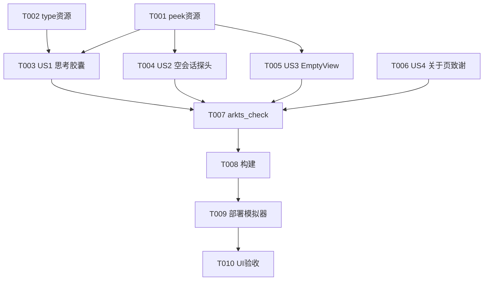

# Tasks: OctopPet 吉祥物动效素材集成（mascot-integration）

**Input**: Design documents from `spec/mascot-integration/`
**Prerequisites**: plan.md (required), spec.md (required for user stories)
**Tests**: 未要求独立测试任务（以 Verification 阶段构建 + 模拟器 UI 实测验收）

## Format: `[ID] [P?] [Story] Description`

- **[P]**: Can run in parallel (different files, no dependencies)
- **[Story]**: Which user story this task belongs to (US1-US4)
- Include exact file paths in descriptions

## Path Conventions

- **单项目根**: `C:\Users\13775\OctopLink`（PROJECT_ROOT）
- ArkTS 源码: `entry/src/main/ets/`；资源: `entry/src/main/resources/base/media/`
- 素材源（临时目录）: `C:\Users\13775\AppData\Local\Temp\deveco\octoppet_src\jubaoliang-OctopPet-4ed0711\public\mascots\`

---

## Phase 1: Setup（资源落地）

**Purpose**: 将两个吉祥物素材加入应用媒体资源目录

- [x] T001 复制探头章鱼素材：`C:\Users\13775\AppData\Local\Temp\deveco\octoppet_src\jubaoliang-OctopPet-4ed0711\public\mascots\peek.webp` → `C:\Users\13775\OctopLink\entry\src\main\resources\base\media\octop_mascot_peek.webp`（二进制复制，不重编码，校验字节数 249002）
- [x] T002 [P] 复制打字章鱼素材：`C:\Users\13775\AppData\Local\Temp\deveco\octoppet_src\jubaoliang-OctopPet-4ed0711\public\mascots\type.webp` → `C:\Users\13775\OctopLink\entry\src\main\resources\base\media\octop_mascot_type.webp`（二进制复制，不重编码，校验字节数 378064）

**Checkpoint**: 资源就位，`$r('app.media.octop_mascot_peek')` / `$r('app.media.octop_mascot_type')` 可被引用

---

## Phase 2: User Story 1 - 思考胶囊打字章鱼（Priority: P1）🎯 MVP

**Goal**: AI 等待/流式阶段，思考胶囊中心由静态 logo 升级为打字章鱼循环动画，双弧线环绕保留
**Independent Test**: 聊天页发送消息，观察思考胶囊出现打字章鱼动画，流式结束后胶囊整体消失

- [x] T003 [P] [US1] 修改 `C:\Users\13775\OctopLink\entry\src\main\ets\components\OctopThinkingIndicator.ets`：将弧线环绕中心的 `Image($r('app.media.octop_logo'))`（0.55×indSize 正方形 + borderRadius）替换为 `Image($r('app.media.octop_mascot_type'))`，显式宽 32vp × 高 16vp（indSize=44 时，保持素材 88:44 原始宽高比，半对角 17.9 < 弧线圆半径 22 不触碰弧线），`.objectFit(ImageFit.Contain)` + `.interpolation(ImageInterpolation.None)` 保持像素锐利；双弧线动画（animateTo/dashArc/颜色）与组件签名 `indSize` 零改动

**Checkpoint**: US1 独立可测（发送消息触发 streaming）

---

## Phase 3: User Story 2 - 空会话欢迎卡探头章鱼（Priority: P1）

**Goal**: 空会话空态在 WelcomeCard 上方显示探头章鱼循环动画
**Independent Test**: 进入无消息的空会话，观察欢迎卡上方探头章鱼动画；发消息后随空态消失

- [x] T004 [P] [US2] 修改 `C:\Users\13775\OctopLink\entry\src\main\ets\pages\chat\ChatHomeTab.ets` 的 `emptyStateBuilder`：在最顶部（WelcomeCard 之前）新增 `Image($r('app.media.octop_mascot_peek'))`，显式宽 90vp × 高 60vp（保持 96:64 原始宽高比），`.objectFit(ImageFit.Contain)` + `.interpolation(ImageInterpolation.None)`，随空态 Column 水平居中（父容器 alignItems 已居中则继承）；WelcomeCard（welcome 非空分支）与最近会话卡（recentThreadCard 分支）逻辑、条件、布局零改动

**Checkpoint**: US2 独立可测（空会话渲染）

---

## Phase 4: User Story 3 - 通用空态 EmptyView 探头章鱼（Priority: P2）

**Goal**: EmptyView 默认图标升级为探头章鱼动画，全 App 30+ 空态统一品牌化；保留回退参数
**Independent Test**: 打开任一空数据页（如专家列表空态），图标区显示探头章鱼；传 mascot=false 回退原形态

- [x] T005 [P] [US3] 修改 `C:\Users\13775\OctopLink\entry\src\main\ets\components\EmptyView.ets`：新增普通成员 `mascot: boolean = true`；mascot 为 true 时图标区渲染 `Image($r('app.media.octop_mascot_peek'))`（宽 96vp × 高 64vp，Contain + None 插值，替代原 96×96 双层圆形徽章 + SymbolGlyph 整枝），mascot 为 false 时完整渲染原徽章结构（现状逐行保留）；`title`/`subtitle`/`icon` 成员语义与外层 Column 的 space/padding/对齐零改动；全部现有调用方（30+ 处）零修改

**Checkpoint**: US3 独立可测（任一空态页）

---

## Phase 5: User Story 4 - 关于页开源致谢 MIT 合规（Priority: P1）

**Goal**: 关于页新增开源致谢卡，履行 MIT 许可证声明义务
**Independent Test**: 我的 → 关于页，版本卡下方可见"开源致谢"卡与 OctopPet MIT 文案

- [x] T006 [P] [US4] 修改 `C:\Users\13775\OctopLink\entry\src\main\ets\pages\me\AboutPage.ets`：在版本行卡之后、"基于 HarmonyOS ArkUI 构建"文本之前新增开源致谢卡（bg_card 圆角卡样式与版本卡一致：padding 14、borderRadius 16、card_stroke 边框），卡内含标题"开源致谢"（fontSize 15，text_primary）与正文（fontSize 13，text_secondary，行高宽松），正文语义："应用内吉祥物动效素材（探头章鱼、打字章鱼）源自开源项目 OctopPet（作者 jubaoliang），基于 MIT License 授权使用。"；与版本号加载逻辑完全解耦，静态渲染

**Checkpoint**: US4 独立可测（关于页滚动可见）

---

## Phase 6: Polish（静态回归）

**Purpose**: 全部改动文件的 ArkTS 静态检查

- [x] T007 对 4 个修改文件运行 arkts_check 静态检查（`OctopThinkingIndicator.ets`、`ChatHomeTab.ets`、`EmptyView.ets`、`AboutPage.ets`），修复全部诊断至零告警

---

## Phase 7: Verification

<!-- verification_scope: build+ui -->

**Purpose**: 构建、部署到模拟器，并按用户故事逐项 UI 验收

- [x] T008 构建项目并修复全部编译错误（执行 `devecocli build`，在 `C:\Users\13775\OctopLink` 下；迭代修复直至构建成功）
- [x] T009 部署应用到模拟器 127.0.0.1:5555（执行 `devecocli run --skip-build`；如模拟器离线先启动；锁屏则上滑 + 密码 Abc541755 解锁）
- [x] T010 对部署后的应用执行 UI 验收（手动路径：uinput 触控 + dumpLayout + snapshot_display 截图 + 像素亮度分析 + recognize_ui_components），逐项验收：
  - US1：发送消息触发 streaming，思考胶囊内打字章鱼动画可见、双弧线保留；流式结束胶囊消失无残留
  - US2：空会话欢迎卡上方探头章鱼可见；发送消息后章鱼随空态消失
  - US3：抽查 ≥2 处 EmptyView 空态（专家列表空态 + 任一工作台/会话类空态）显示探头章鱼，标题副标题布局不回归
  - US4：我的 → 关于页开源致谢卡与 MIT 文案可见
  - 回归红线：登录页、工作台正常态、我的页、第十二批键盘态/滚动/任务面板行为视觉零变化；hilog 无 FATAL

---

## 📊 Dependency Graph



## ⚡ Parallel Execution Guide

| Phase | Tasks | Required Files | Execution Notes |
|---|---|---|---|
| Setup | T001, T002 | resources/base/media/（两个新文件） | 纯文件复制，可并行 |
| US1-US4 | T003, T004, T005, T006 | 四个互不相同的 .ets 文件 | 全部可并行（不同文件、无交叉依赖） |
| Polish | T007 | 4 个修改文件 | 必须在 T003-T006 全部完成后执行 |
| Verification | T008 → T009 → T010 | 构建产物 | 严格串行 |

## Parallel Example: User Story 1-4 并行实施

```bash
# 资源就位后，四个用户故事改动文件互不相同，可同时启动：
Task: T003 "思考胶囊打字章鱼" → components/OctopThinkingIndicator.ets
Task: T004 "空会话探头章鱼"   → pages/chat/ChatHomeTab.ets
Task: T005 "EmptyView 章鱼"   → components/EmptyView.ets
Task: T006 "关于页致谢"       → pages/me/AboutPage.ets
```

---

## Dependencies & Execution Order

### Phase Dependencies

- **Setup (Phase 1)**: 无依赖，立即开始；阻塞全部用户故事（资源必须先就位）
- **US1-US4 (Phase 2-5)**: 各自依赖 T001/T002 对应资源；四故事之间零依赖，可并行
- **Polish (Phase 6)**: 依赖全部用户故事完成（T003-T006）
- **Verification (Phase 7)**: 依赖 Polish 完成；内部严格串行 T008 → T009 → T010

### Within Each User Story

- 资源先于引用（T001/T002 → T003/T004/T005）
- 单文件单任务，无任务内部分步依赖

---

## Implementation Strategy

### MVP First（User Story 1 Only）

1. 完成 Phase 1（资源落地）
2. 完成 T003（思考胶囊打字章鱼）
3. **STOP and VALIDATE**: 发送消息独立验证 US1
4. 部署演示（MVP 即品牌核心场景）

### Incremental Delivery

1. Setup → 资源就位
2. +US1 思考胶囊 → 独立验证（MVP）
3. +US2 空会话探头 → 独立验证
4. +US3 EmptyView 全空态 → 独立验证
5. +US4 关于页致谢 → 独立验证（MIT 合规收口）
6. Polish → Verification 全量验收

---

## Notes

- 总任务数 10（T001-T010）：Setup×2、US1×1、US2×1、US3×1、US4×1、Polish×1、Verification×3
- 并行机会：Setup 2 任务并行；US1-US4 四任务完全并行（不同文件零交叉）
- 独立验收：每个 US 可在模拟器单独触发（发送消息 / 空会话 / 空数据页 / 关于页）
- MVP scope：T001+T002+T003
- 素材复制必须二进制原样（不重编码不重采样），字节数校验 249002 / 378064
- 回归红线见 plan.md Contracts & Interfaces：第十二批全部行为不得回归
- [P] tasks = different files, no dependencies；[Story] 标签映射 spec.md 用户故事

