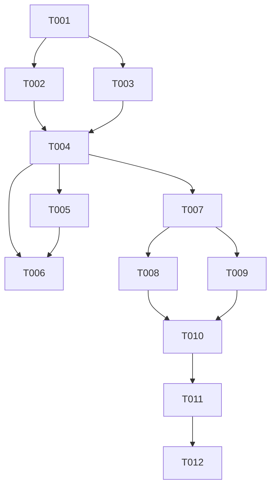

# Tasks: App 端本机 TTS 引擎接入与后端选择（Message TTS Local Engine）

**Input**: Design documents from `spec/message-tts/`
**Prerequisites**: plan.md (required), spec.md (required for user stories)

**Tests**: 未在规格中要求自动化测试，不生成测试任务；验证走构建+部署（build-only）。

**Organization**: 任务按 User Story 分组（US1/US2/US3），支持独立实现与独立验证。

## Format: `[ID] [P?] [Story] Description`

- **[P]**: 可并行（不同文件、无未完成依赖）
- **[Story]**: 所属 User Story（US1/US2/US3）
- 描述含精确文件路径

## Path Conventions

- 项目根：`C:\Users\13775\OctopLink\`（既有 HarmonyOS 工程，entry 模块）
- ArkTS 源码：`entry/src/main/ets/`

---

## Phase 1: Setup (Shared Infrastructure)

**Purpose**: 既有工程增量功能，无脚手架需求；仅需实现前置上下文准备。

- [x] T001 加载 hmos-arkui-develop-skill，通读四个改造目标文件并定位挂点：`entry/src/main/ets/components/MessageBubble.ets`（toggleSpeak 既有服务器链路与按钮三态）、`entry/src/main/ets/pages/me/VoiceSettingsPage.ets`（TTS 区卡片结构与激活动作）、`entry/src/main/ets/store/AppPrefs.ets`（preferences 读写模式）、`entry/src/main/ets/pages/chat/ChatHomeTab.ets`（aboutToDisappear 与切会话时消息列表重置点）

---

## Phase 2: Foundational (Blocking Prerequisites)

**Purpose**: 所有 User Story 依赖的模型、持久化键与引擎封装服务。

**⚠️ CRITICAL**: 本阶段完成前不得开始任何 User Story。

- [x] T002 [P] 新建 `entry/src/main/ets/model/TtsModels.ets`：TtsSettingsModel（backend/speed/pitch/volume/person/online，含 clamp 校验与默认值 'server'/1.0/1.0/2/13/1）、VoiceOptionModel（person/displayName/status）、静态兜底音色清单（13 玲小姗·推荐/21 玲飞哲·需下载/0 默认女声）
- [x] T003 [P] 扩展 `entry/src/main/ets/store/AppPrefs.ets`：新增 6 键读写（tts_backend/tts_speed/tts_pitch/tts_volume/tts_person/tts_online），数值字符串存取+类型归一（NaN 回退默认），沿用既有 getString/putString 私有方法模式
- [x] T004 实现 `entry/src/main/ets/service/LocalTtsService.ets`（依赖 T002、T003）：CoreSpeechKit `textToSpeech` 封装——canIUse 可用性检测、引擎懒创建/复用/person-online 变更重建标记、SpeakListener 单次注册按 requestId 分发到当前活动请求回调、单活动请求打断语义（新 speak 先停旧请求）、ensureLoaded/getSettings/setSettings/isLocalBackend、speak（文本 ≤10000 截断、引擎不可用 reject）/stop/release、listVoices（离线 zh-CN 查询，失败回退静态清单）

**Checkpoint**: 模型/持久化/引擎服务就绪，US1 与 US2 可开始。

---

## Phase 3: User Story 1 - 语音设置选择本机引擎并配置参数 (Priority: P1) 🎯 MVP

**Goal**: 语音设置页 TTS 区出现「本机引擎」卡片，可设为当前后端，可打开完整参数面板配置并持久化。

**Independent Test**: 语音设置页找到本机引擎卡片 → 设为当前 → 修改语速保存 → 重进页面验证激活态与参数保持。

- [x] T005 [P] [US1] 新建 `entry/src/main/ets/components/LocalTtsConfigDialog.ets`（依赖 T004）：@CustomDialog 参数面板——语速滑杆(0.5-2.0/0.05)、音调滑杆(0.5-2.0/0.05)、音量滑杆(0-2/0.1)、音色单选（打开时 LocalTtsService.listVoices 动态加载，失败用静态兜底，标注 已安装/可下载 状态）、模式切换（离线=默认推荐；在线附"当前引擎版本暂不支持在线模式"提示）、取消/保存（保存回传 clamp 后的完整 TtsSettingsModel）
- [x] T006 [US1] 修改 `entry/src/main/ets/pages/me/VoiceSettingsPage.ets`（依赖 T004、T005）：TTS 区新增「本机引擎」卡片（标题「本机引擎（设备端合成）」、副标题「离线朗读·无需服务器·零流量」、参数摘要行、激活态样式与服务器预设一致）；「设为当前」→ LocalTtsService.setSettings(backend='local')；任一服务器预设「设为当前」→ 既有 putActive 流程 + setSettings(backend='server')；两处激活动作前统一停止双链路朗读（LocalTtsService.stop() + AudioIOService.stopPlayback()）；「配置」打开 LocalTtsConfigDialog 并接线保存

**Checkpoint**: US1 独立可用——后端选择与参数配置闭环。

---

## Phase 4: User Story 2 - 本机引擎朗读消息 (Priority: P1)

**Goal**: 后端为本机引擎时，朗读按钮端侧合成播放（零网络请求），按钮三态与服务器链路一致。

**Independent Test**: 激活本机引擎后，对一条已完成助手回复点朗读，验证出声、停止态、再点停止、播完复位；切回服务器后端验证既有链路不变。

- [x] T007 [US2] 修改 `entry/src/main/ets/components/MessageBubble.ets`（依赖 T004）：toggleSpeak 分流——await LocalTtsService.ensureLoaded() 后 isLocalBackend() 为真走 LocalTtsService.speak(ttsPlainText() 结果, 回调驱动 speaking/speakingBusy/玫瑰底停止态/toast)，否则保持既有 VoiceService.tts + AudioIOService.playTts 链路完全不变；本机链路复用 ttsPlainText 的 Markdown 剥离与按钮三态渲染

**Checkpoint**: US2 独立可用——端侧朗读闭环，服务器链路回归无损。

---

## Phase 5: User Story 3 - 后端切换、降级与生命周期兜底 (Priority: P2)

**Goal**: 朗读中切后端/切会话/离页立即停止；无引擎或合成失败优雅降级；无 busy 卡死与残留声音。

**Independent Test**: 朗读中切后端或切会话验证声音停止与按钮复位；无引擎环境（模拟器）点朗读验证仅出提示且聊天正常。

- [x] T008 [P] [US3] 修改 `entry/src/main/ets/pages/chat/ChatHomeTab.ets`（依赖 T004、T007）：aboutToDisappear 与切会话（消息列表重置处）调用统一停止（LocalTtsService.stop() + AudioIOService.stopPlayback()）；不持有引擎引用、不感知后端细节
- [x] T009 [US3] 异常与边界加固（依赖 T007，涉及 `entry/src/main/ets/service/LocalTtsService.ets` 与 `entry/src/main/ets/components/MessageBubble.ets`）：onError/onStop 必须复位 speakingBusy 防按钮卡死；引擎不可用/初始化失败/合成失败统一简洁 toast（「本机语音引擎不可用」「朗读失败」）；空文本直接返回；超长文本截断到 10000 字符；person/online 变更后的下一次 speak 前重建引擎；朗读中切换后端（US1 的停止动作）触发旧请求 onStop 复位

**Checkpoint**: 全部 User Story 独立可用，异常路径闭环。

---

## Phase 6: Polish & Cross-Cutting Concerns

**Purpose**: 跨 Story 质量收口。

- [x] T010 [P] 全量 ArkTS 规范收口：检查新增/修改的 4+3 个文件无未用导入、无 any/解构/裸对象字面量、日志走 `entry/src/main/ets/utils/Logger`、ForEach 带 key、V1 状态装饰器不混用 V2

---

## Phase 7: Verification

<!-- verification_scope: build-only -->

**Purpose**: 构建与部署验证（不含 UI 自动化验证；音频出声需真机人工确认）。

- [x] T011 运行 arkts_check 后执行 `devecocli build` 并修复编译错误（iterate 修复→重建直至成功）
- [x] T012 部署应用到模拟器（127.0.0.1:5555）：`devecocli run --skip-build`（验证安装可启动；模拟器可能无 TTS 引擎，朗读出声需真机人工确认）

---

## Dependencies & Execution Order

### 任务依赖图



### Phase 依赖

- **Setup (T001)**: 无依赖，立即开始
- **Foundational (T002-T004)**: 依赖 T001；T004 阻塞全部 User Story
- **User Stories (T005-T009)**: 依赖 T004；US1/US2 可并行；US3 依赖 US2 的朗读链路落地
- **Polish (T010)**: 依赖全部实现任务
- **Verification (T011-T012)**: 严格串行殿后

## ⚡ Parallel Execution Guide

| Phase | Tasks | Required Files | Execution Notes |
|-------|-------|----------------|-----------------|
| Setup | T001 | 4 个改造目标文件 | 单任务，先行 |
| Foundational | T002 ∥ T003 | TtsModels.ets / AppPrefs.ets | 不同文件可并行；T004 串行殿后 |
| US1+US2 | T005 ∥ T007 | LocalTtsConfigDialog.ets / MessageBubble.ets | 均仅依赖 T004，可并行 |
| US3 | T008 ∥ T009 | ChatHomeTab.ets / LocalTtsService.ets+MessageBubble.ets | T009 与 T008 可并行（T009 触碰 MessageBubble 需在 T007 后） |
| Verification | T011 → T012 | 构建产物 | 严格串行 |

## Parallel Example

```text
# Foundational 并行组（不同文件、无依赖）：
Task: T002 新建 model/TtsModels.ets
Task: T003 扩展 store/AppPrefs.ets

# US1/US2 并行组（均仅依赖 T004）：
Task: T005 [US1] 新建 components/LocalTtsConfigDialog.ets
Task: T007 [US2] 修改 components/MessageBubble.ets
```

## Implementation Strategy

### MVP First（US1 + US2 为 P1 核心）

1. T001 → T002/T003 → T004（基础就绪）
2. T005 → T006（后端选择与参数配置可用）
3. T007（端侧朗读闭环）→ **STOP 验证 MVP**：设为本机引擎 → 朗读出声（真机）
4. T008/T009 → T010 → T011 → T012

### Incremental Delivery

每个 Checkpoint 均可独立部署验证：US1 交付后即可演示后端选择；US2 交付后即可演示端侧朗读；US3 交付后异常路径闭环。

## Notes

- [P] 任务 = 不同文件且无未完成依赖
- [Story] 标签映射 spec.md User Story 以保证可追溯
- TTS 引擎参数语义以 SDK 声明为准（online 仅 1=离线受支持；speed/volume/pitch 走 SpeakParams.extraParams）
- 模拟器（127.0.0.1:5555）为默认测试目标；真机（192.168.3.190:44541）仅出声人工确认用，不自动推送
- 服务器端零改动；既有服务器 TTS 链路行为必须保持回归无损
