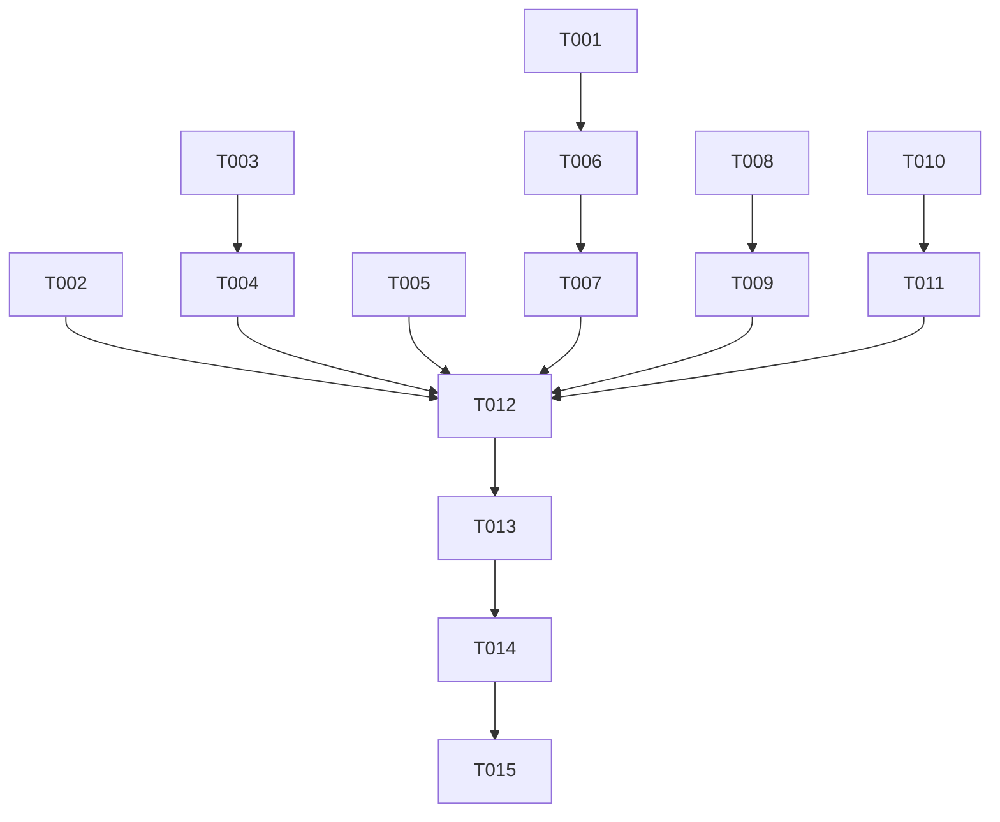

# Tasks: 第四批精修+排障（ui-refine-batch-3）

**Input**: Design documents from `spec/ui-refine-batch-3/`
**Prerequisites**: plan.md (required), spec.md (required for user stories)

**Tests**: 无独立测试任务；验证走 Verification 阶段（build + 部署 + 逐条 UI 验收）。

**Organization**: 按用户故事分组，8 个故事对应 8 项需求；同文件任务串行、跨文件任务可并行。

## Format: `[ID] [P?] [Story] Description`

- **[P]**: 可并行（不同文件、无依赖）
- **[Story]**: 所属用户故事（US1-US8）
- 描述含精确文件路径

## Path Conventions

- 既有单工程：`entry\src\main\ets\`（源码）与 `entry\src\main\resources\`（资源）
- 所有路径相对 `C:\Users\13775\OctopLink\`

---

## Phase 1: Setup

**Purpose**: 资源与上下文确认（既有工程，无脚手架需求）

- [X] T001 确认品牌 Logo 源资源存在：`C:\Users\13775\AppData\Local\Temp\deveco\octop_src\TencentCloud-Octop-890111b\dashboard\src\assets\channels\`（feishu/dingtalk/wecom/weixin/qq/yuanbao/telegram/discord.svg 等），并列出 ChannelPage 实际出现的渠道 kind 清单（`entry\src\main\ets\pages\workspace\ChannelPage.ets` 的 qrPlatforms/kinds）

**Checkpoint**: 资源就绪、kind 清单明确

---

## Phase 2: Foundational

无阻塞前置任务——8 个故事彼此独立，全部仅改展示层/交互层/一处网络 header，共享基础（V1 状态管理、UiMaterialKit、HttpClient）已存在。

**Checkpoint**: 直接进入用户故事

---

## Phase 3: User Story 1 - 语音识别 422 修复 (Priority: P1) 🎯 MVP

**Goal**: multipart 上传补 Content-Type，语音识别恢复，全部 13 处 multipart 上传一并修复

**Independent Test**: 聊天页录音≥2 秒→停止→无 422 toast；hilog 显示 POST /api/voice/stt 返回 200（服务器 STT 可用时识别文字进输入框）

### Implementation for User Story 1

- [X] T002 [P] [US1] 在 `entry\src\main\ets\net\HttpClient.ets` 的 postMultipartFile 请求 header 中新增 `'Content-Type': 'multipart/form-data'`（约 L138-143 header 构造处；boundary 由 netstack 自动补全，不手写）；保持方法签名、multiFormDataList、超时、错误包络解析不变

**Checkpoint**: US1 完成——录音上传请求体正确发出

---

## Phase 4: User Story 2 - 导航栏光感还原（系统 TabBar）(Priority: P1)

**Goal**: 还原系统 Tabs 底部 TabBar 并挂载沉浸光感材质，移除自绘导航栏与键盘下沉动画

**Independent Test**: 主页底部导航栏呈毛玻璃+高光材质，内容滚动从其后透出；四标签切换正常；键盘弹出/收起无导航栏动画

### Implementation for User Story 2

- [X] T003 [P] [US2] 在 `entry\src\main\ets\pages\MainPage.ets` 移除第三批自绘导航栏与键盘动画逻辑：floatingNavBar 自绘 Row、keyboardOn/keyboardHeightChange 监听、contentBottomPad 键盘避让量及相关 @State/@StorageLink 死代码（保留 `@StorageLink('immersive.light.on')` immersiveOn——继续驱动材质输出）
- [X] T004 [US2] 在 `entry\src\main\ets\pages\MainPage.ets` 恢复系统 Tabs 底部 TabBar：`barPosition(BarPosition.End)` + 四 TabContent（专家/聊天/工作台/我的，tabBar 图标+文字+当前态高亮沿用现有资源与样式），并按官方 Tabs 文档调用 `barFloatingStyle(FloatingTabBarStyle)` 挂载 `systemMaterial: UiMaterialKit.navBarMaterial()`（需同时满足 barOverlap(true)+vertical(false)+barPosition(BarPosition.End) 三条件；低版本/不可用时降级普通 TabBar；写组件前先加载 hmos-arkui-develop-skill 并查阅 references 中 Tabs/FloatingTabBarStyle 用法与 API 26 兼容性）

**Checkpoint**: US2 完成——系统 TabBar 光感还原、四标签路由无回归

---

## Phase 5: User Story 3 - 模型配置卡片点击编辑 (Priority: P2)

**Goal**: provider 卡片单击即弹操作菜单，"编辑"稳定打开表单

**Independent Test**: 模型配置页单击卡片→菜单弹出→点"编辑"→表单打开且预填

### Implementation for User Story 3

- [X] T005 [P] [US3] 在 `entry\src\main\ets\pages\me\ProvidersPage.ets`：① provider 卡片增加 onClick 触发与长按相同的 showProviderMenu；② 编辑用 bindSheet 从 `if (this.canManage)` 条件 FAB 移到页面常驻根节点，消除菜单关闭与 sheet 挂载的时序冲突；只读用户行为保持不变

**Checkpoint**: US3 完成——编辑入口可发现且稳定

---

## Phase 6: User Story 4 - 渠道列表品牌 Logo (Priority: P2)

**Goal**: 渠道卡片左侧 44×44 徽章显示品牌 Logo，未知 kind 回退文字徽章

**Independent Test**: 飞书渠道卡片显示飞书 Logo；未知 kind 渠道显示原文字徽章；停用渠道降透明度保持

### Implementation for User Story 4

- [X] T006 [P] [US4] 将 dashboard 品牌资源（T001 确认的 kind 清单对应的 feishu/dingtalk/wecom/weixin/qq/yuanbao 等 svg/png）复制到 `entry\src\main\resources\base\media\`（文件名与 kind 对应，全小写）
- [X] T007 [US4] 在 `entry\src\main\ets\pages\workspace\ChannelPage.ets`：新增 kind→Resource 映射常量，渠道卡片 44×44 徽章按 kind 渲染 `Image($r('app.media.xxx'))` 圆角填充；映射外 kind 回退现有 platformBadge 文字+渐变徽章（L228/L837-857 处）；停用态降透明度视觉保持

**Checkpoint**: US4 完成——品牌识别度提升，无空白徽章

---

## Phase 7: User Story 5 - 气泡用量移框内右下角 (Priority: P2)

**Goal**: token 用量从气泡外右侧胶囊移到气泡框内右下角

**Independent Test**: 带用量消息气泡内右下角显示 ↑↓；气泡外右侧无胶囊；无用量消息不占位

### Implementation for User Story 5

- [X] T008 [P] [US5] 在 `entry\src\main\ets\components\MessageBubble.ets`：删除气泡外右侧竖排用量胶囊及外层包裹（L497-511 及外层 Row VerticalAlign.Bottom 结构），改为气泡内容列底部右对齐（HorizontalAlign.End）的用量行放气泡框内；无用量数据不渲染不占位

**Checkpoint**: US5 完成——用量归位框内

---

## Phase 8: User Story 6 - 操作按钮放大 20%/底距缩小 20% (Priority: P3)

**Goal**: 复制/朗读/重试按钮容器 20→24、图标 12→14；操作行与气泡底边距离 14→11

**Independent Test**: 按钮目视放大约 20%、底距目视缩小约 20%；三按钮功能正常

### Implementation for User Story 6

- [X] T009 [US6] 在 `entry\src\main\ets\components\MessageBubble.ets`：操作行按钮容器 20vp→24vp、内部图标 12vp→14vp（放大 20%），操作行与气泡底边 margin 14→11（缩小 20%）；复制/朗读三态/重试交互逻辑不动（T008 后同文件串行执行）

**Checkpoint**: US6 完成——可点按性提升

---

## Phase 9: User Story 7 - 输入框与导航栏同宽 (Priority: P3)

**Goal**: 输入卡左右边距 12→16，与系统 TabBar 内容边距一致

**Independent Test**: 聊天页底部输入卡左右边缘与导航栏内容区对齐

### Implementation for User Story 7

- [X] T010 [P] [US7] 在 `entry\src\main\ets\pages\chat\ChatHomeTab.ets`：输入卡 margin left/right 12→16（约 L2680）；其余卡片圆角/背景不动

**Checkpoint**: US7 完成——左右同宽

---

## Phase 10: User Story 8 - 新会话按钮对齐发送并抬高 (Priority: P3)

**Goal**: 新会话按钮中心与发送按钮中心竖向对齐（offset x≈-25）并抬高（y 约 -52→-64）

**Independent Test**: 两按钮中心基本同一垂直线；新会话按钮更高；点击新会话流程正常

### Implementation for User Story 8

- [X] T011 [US8] 在 `entry\src\main\ets\pages\chat\ChatHomeTab.ets`：新会话按钮 offset 由 {x:-2, y:-52} 调整为 x≈-25（对齐发送按钮中心 x≈1092px/3.5≈312vp）、y 抬高至约 -64（以截图验收微调，不遮挡最后一条消息正文）；按钮功能不动（T010 后同文件串行执行）

**Checkpoint**: US8 完成——对齐+抬高

---

## Phase 11: Polish & Cross-Cutting Concerns

**Purpose**: 清理与回归保障

- [X] T012 全局回归自查：确认 MainPage 移除自绘导航栏后无残留引用（keyboardOn/keyboardHeightChange/floatingNavBar/contentBottomPad 及未使用的 import/资源）；确认第三批已交付功能未回退（TTS 朗读三态、QR 扫码、MenuSheet、MeTab 支持节、四标签路由）；对改动过的 5 个 .ets 文件跑 `arkts_check`

---

## Phase 12: Verification

<!-- verification_scope: build+ui -->

**Purpose**: 构建、部署模拟器、逐条验收 8 项需求

- [X] T013 Build project and fix any compilation errors（invoke `devecocli build`，workdir=`C:\Users\13775\OctopLink`；iterate fix → build until success）
- [X] T014 Deploy application to emulator（invoke `devecocli run --skip-build --device 127.0.0.1:5555`）
- [X] T015 Run UI verification against deployed application：逐条验收 8 项——①录音≥2s 停止后无 422、hilog 200、识别文字进输入框（服务器 STT 可用时）；②导航栏系统 TabBar 材质+高光、四标签切换、键盘弹出无导航栏动画、滚动透出；③模型配置页单击卡片弹菜单→编辑表单打开预填；④渠道卡片品牌 Logo（飞书等）、未知 kind 回退、停用态降透明；⑤用量在气泡框内右下角、框外无胶囊、无数据不占位；⑥按钮约放大 20%、底距约缩小 20%、复制/朗读/重试正常；⑦输入卡与导航栏同宽；⑧新会话按钮对齐发送并抬高、点击功能正常。工具链：`hdc -t 127.0.0.1:5555 shell uinput -T -c <x> <y>` 点击、`uitest dumpLayout`（UTF8 读取）、`snapshot_display`（仅 .jpeg，转 PNG 放 `C:\Users\13775\OctopLink\.cache.screens\` 供 VLM recognize_ui_components）、`hdc shell hilog -x` 日志验证

---

## Dependencies & Execution Order

### Phase Dependencies

- **Setup (Phase 1)**: T001 先行（US4 的资源与 kind 清单依赖它）
- **Foundational (Phase 2)**: 无
- **User Stories (Phase 3-10)**: 互相独立；同文件内串行：T003→T004（MainPage）、T006→T007（资源→渲染）、T008→T009（MessageBubble）、T010→T011（ChatHomeTab）
- **Polish (Phase 11)**: 依赖全部故事完成
- **Verification (Phase 12)**: 依赖 T012

### 📊 Dependency Graph



### ⚡ Parallel Execution Guide

| Phase | Tasks | Required Files | Execution Notes |
|-------|-------|----------------|-----------------|
| US1 | T002 | net/HttpClient.ets | 与其余故事完全并行（一行 header 修复） |
| US2 | T003→T004 | pages/MainPage.ets | 先删自绘再还原系统 Tabs，同文件串行 |
| US3 | T005 | pages/me/ProvidersPage.ets | 独立 |
| US4 | T006→T007 | resources/base/media/、pages/workspace/ChannelPage.ets | 先复制资源再写渲染 |
| US5+US6 | T008→T009 | components/MessageBubble.ets | 同文件串行 |
| US7+US8 | T010→T011 | pages/chat/ChatHomeTab.ets | 同文件串行 |

## Implementation Strategy

1. T001 Setup → 并行推进 8 个故事（各文件组独立）
2. T012 Polish 全局自查
3. T013-T015 Verification：build→部署模拟器→逐条验收 8 项（对照 spec.md 各 US 验收场景）
4. 验收标准：8/8 通过；光感材质最终视觉效果以用户真机复验为准（模拟器仅验证结构与降级路径）

## Summary Report

- **Total tasks**: 15（Setup 1 / Stories 10 / Polish 1 / Verification 3）
- **Per-story count**: US1:1、US2:2、US3:1、US4:2、US5:1、US6:1、US7:1、US8:1
- **Parallel opportunities**: 6 个文件组可并行（HttpClient/MainPage/ProvidersPage/media+ChannelPage/MessageBubble/ChatHomeTab）
- **Independent test criteria**: 每个故事均有独立验证方式（见各 Phase Independent Test）
- **MVP scope**: US1（422 修复）+ US2（导航栏还原）为 P1 核心

---

## Parallel Example: User Story 2

```text
# 文件组内串行、组间并行：
Task T003: "移除 MainPage 自绘导航栏/键盘动画" (pages/MainPage.ets)
Task T004: "恢复系统 Tabs 底部 TabBar + barFloatingStyle 材质" (pages/MainPage.ets, 依赖 T003)

# 同时可并行推进的其他文件组：
Task T002: HttpClient.ets (net/)
Task T005: ProvidersPage.ets (pages/me/)
Task T006: resources/base/media/ (资源复制)
Task T008: MessageBubble.ets (components/)
Task T010: ChatHomeTab.ets (pages/chat/)
```

---

## Notes

- [P] 任务 = 不同文件、无依赖
- [Story] 标签将任务映射到 spec.md 用户故事，保证可追溯
- 每个故事可独立完成与验证（Incremental Delivery）
- 同文件多任务必须按 ID 顺序串行（T003→T004、T008→T009、T010→T011）
- 写/改 .ets 前必须加载 hmos-arkui-develop-skill；禁止裸对象字面量传参、any/unknown、as 断言（arkts 严格模式）
- 服务器端零改动；部署验证一律推模拟器（127.0.0.1:5555），真机（192.168.3.190:44541）仅在用户明确要求时推送
- 完成每个任务或逻辑分组后提交（本批按一次交付，Verification 后统一验收）
