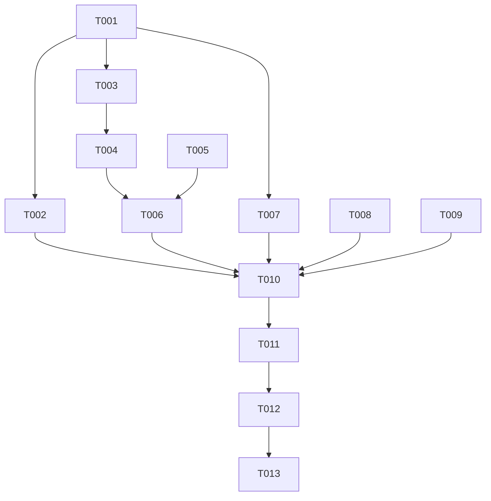

# Tasks: 第五批精修+排障（ui-refine-batch-4）

**Input**: Design documents from `spec/ui-refine-batch-4/`
**Prerequisites**: plan.md (required), spec.md (required for user stories)

**Tests**: 无独立测试任务；验证走 Verification 阶段（build + 部署 + 逐条 UI 验收）。

**Organization**: 按用户故事分组，6 个故事对应 6 项需求；同文件任务串行、跨文件任务可并行。

## Format: `[ID] [P?] [Story] Description`

- **[P]**: 可并行（不同文件、无依赖）
- **[Story]**: 所属用户故事（US1-US6）
- 描述含精确文件路径

## Path Conventions

- 既有单工程：`entry\src\main\ets\`（源码）与 `entry\src\main\resources\`（资源）
- 所有路径相对 `C:\Users\13775\OctopLink\`

---

## Phase 1: Setup

**Purpose**: 上下文确认（既有工程，无脚手架需求）

- [x] T001 确认服务端契约与客户端现状：①服务端 rankings 响应样例（`GET /api/agents/{id}/skills/hub/rankings?type=recommended` → {section, skills, total}，skills 项含 iconUrl）；②`/api/mobile/status` 响应字段（ok/mobile_supported/reason/devices）；③ProvidersPage 根节点当前两个 bindSheet（modelSheetOpen L891 + formOpen L897）与 PluginPage 单 bindSheet 分发模式（L600 附近 sheetMode: market/url/tools）；④ToolSettingsPage 工具项渲染段（available=false 分支）与 ToolSettingItemModel 字段

**Checkpoint**: 契约与现状明确

---

## Phase 2: Foundational

无阻塞前置任务——6 个故事彼此独立，全部仅改客户端展示层/交互层/模型解析，共享基础（V1 状态管理、HttpClient、JsonHelper）已存在。

**Checkpoint**: 直接进入用户故事

---

## Phase 3: User Story 1 - 全局默认模型点击修复 (Priority: P1) 🎯 MVP

**Goal**: 单 bindSheet 分发修复点击无反应回归，模型选择与编辑表单互斥共存

**Independent Test**: 模型配置页点击"全局默认模型"卡→选择面板弹出；选模型→保存回显；长按 provider→编辑→表单仍正常预填

### Implementation for User Story 1

- [x] T002 [P] [US1] 在 `entry\src\main\ets\pages\me\ProvidersPage.ets`：将根节点同链的两个 bindSheet（`$$this.modelSheetOpen` 与 `$$this.formOpen`）合并为单 bindSheet 分发（参照 PluginPage L600 模式）：①新增 `sheetMode: string`（'' | 'model' | 'form'）状态与单一 open 布尔；②根节点仅链一个 bindSheet，builder 按 sheetMode 分发 modelSheetBuilder/表单 builder，SheetOptions 各自保留现有配置（model: detents [MEDIUM, LARGE]；form: detents [LARGE]；均 systemMaterial: UiMaterialKit.sheet()、showClose）；③openActiveModelPicker 置 mode='model' 后 open=true，openEditForm/openCreateForm 置 mode='form' 后 open=true，关闭统一 open=false；④菜单 bindSheet（menuOpen）独立不变；⑤只读用户点击仍提示需要权限

**Checkpoint**: US1 完成——两半模态均正常、互斥

---

## Phase 4: User Story 2 - 技能市场进入即展示列表 (Priority: P1) 🎯 MVP

**Goal**: 市场标签进入自动加载推荐榜单，无需手动搜索

**Independent Test**: 技能页→市场标签→列表自动出现（含 Loading/错误重试）；搜索"pdf"切换为搜索结果

### Implementation for User Story 2

- [x] T003 [P] [US2] 在 `entry\src\main\ets\service\SkillService.ets`：新增 `static async hubRankings(agentId: string, type: string): Promise<Array<HubRankingSectionModel>>`——`GET /api/agents/${agentId}/skills/hub/rankings?type=${type}`，复用 `HubRankingSectionModel.parseSections` 解析 {section, skills, total} 单分区响应；鉴权与错误处理沿用现有 hubSearch 模式
- [x] T004 [US2] 在 `entry\src\main\ets\pages\workspace\SkillsPage.ets`：①市场标签进入（segIndex 切到 1 或就绪即市场态）且未搜索过（hubSearched=false）时自动调用 `SkillService.hubRankings(agentId, 'recommended')`，Loading 态→成功把 skills 灌入市场列表渲染（与 hubResults 共用列表项渲染），失败展示 ErrorRetry（点重试重拉，不退回空态）；②搜索仍走现有 searchHub 覆盖列表；③下拉刷新重载当前视图（榜单或搜索）；④"未选择专家"提示保持（T003 后同文件串行执行）

**Checkpoint**: US2 完成——市场直出榜单

---

## Phase 5: User Story 3 - 技能市场头像显示 (Priority: P2)

**Goal**: 市场列表项显示技能真实 CDN 头像，缺失/失败回退通用图标

**Independent Test**: 市场列表各技能显示各自头像；无图标项显示魔法棒占位；"我的技能"列表不变

### Implementation for User Story 3

- [x] T005 [P] [US3] 在 `entry\src\main\ets\model\SkillModels.ets`：HubSkillModel 新增 `readonly iconUrl: string` 字段，fromRecord 兼容解析（先 'iconUrl' 再 'icon_url'，两键分别对应榜单/搜索响应——实测确认）；构造函数与 parseList 调用处同步更新
- [x] T006 [US3] 在 `entry\src\main\ets\pages\workspace\SkillsPage.ets`：市场列表项 42×42 徽章改为优先渲染 `Image(iconUrl)`（borderRadius 圆角、objectFit Cover、alt 或 onerror 回退现有通用魔法棒 SymbolGlyph 徽章）；iconUrl 为空直接走通用徽章；"我的技能"列表图标逻辑不动（emoji 优先）（T004 后同文件串行执行）

**Checkpoint**: US3 完成——头像显示、回退可靠

---

## Phase 6: User Story 4 - 手机工具"不可用"原因提示 (Priority: P2)

**Goal**: 不可用 mobile_* 工具展示服务端 /api/mobile/status 的 reason 提示

**Independent Test**: 工具开关页手机系列工具"不可用"标记下方显示服务端原因小字；请求失败回退通用文案；可用工具开关不受影响

### Implementation for User Story 4

- [x] T007 [P] [US4] 在 `entry\src\main\ets\pages\workspace\ToolSettingsPage.ets`：①列表加载后若存在 available=false 且 name 以 `mobile_` 开头的工具，调用 `GET /api/mobile/status`（复用 HttpClient，Bearer 鉴权）；②新增 @State mobileReason: string，请求成功取响应 `reason`（服务端本地化文案），失败/403 置回退文案"服务器未启用远程手机能力，请在服务器配置中开启后重试"；③在不可用手机工具卡片内（"不可用"徽章下方）渲染灰色小字提示；④请求异步不阻断工具列表首屏渲染；⑤无不可用手机工具时不请求不显示；⑥available=true 走现有渲染路径不变

**Checkpoint**: US4 完成——不可用原因可见

---

## Phase 7: User Story 5 - 使用说明详细化 (Priority: P2)

**Goal**: 帮助页扩为 ≥6 节详细分步指南，保持纯本地静态

**Independent Test**: 我的→使用说明：节数≥6、每节含编号步骤与入口路径、滚动流畅、离线可读

### Implementation for User Story 5

- [x] T008 [P] [US5] 在 `entry\src\main\ets\pages\me\HelpPage.ets`：sections 整体重写扩为 ≥6 节详细指南——①快速开始（服务器配置/登录分步）；②聊天详解（发送/附件/语音输入/朗读/会话切换/长按菜单/token 用量含义）；③专家与团队（创建专家/配置模型与工具/团队协作）；④工作台（渠道/知识库/技能与市场/插件/连接器/定时任务/用量统计逐项入口与操作）；⑤我的与设置（外观主题/沉浸光感/模型配置与全局默认模型/语音设置/用户与权限）；⑥常见问题排查（422 与网络错误/权限不足/手机工具不可用原因/语音识别无文字等）；每节含入口路径（如"我的 → 服务器设置"）与编号步骤；保持 HelpSection 结构与卡片式 UI，长文案完整换行显示

**Checkpoint**: US5 完成——内容详细完整

---

## Phase 8: User Story 6 - token 用量与操作按钮平齐 (Priority: P3)

**Goal**: 用量并入操作行与按钮同行平齐（按钮居左、用量靠右、垂直居中）

**Independent Test**: 带用量气泡底部一行内左三按钮右 ↑↓ 用量；操作行下方无独立用量行；无用量右侧不占位；三按钮功能正常

### Implementation for User Story 6

- [x] T009 [P] [US6] 在 `entry\src\main\ets\components\MessageBubble.ets`：删除操作行下方独立用量 Row（L485-497，alignSelf(ItemAlign.End)），把 ↑/↓ 用量两个 Text 并入操作 Row（L429-484）：三按钮后加 `Blank()` 再放用量 Text（fontSize 10、text_tertiary 保持），Row 垂直居中（VerticalAlign.Center）实现平齐；无用量数据时 Blank 收尾不占额外高度；按钮尺寸/交互（24/14、复制/朗读三态/重试）全部不动

**Checkpoint**: US6 完成——同行平齐

---

## Phase 9: Polish & Cross-Cutting Concerns

**Purpose**: 清理与回归保障

- [x] T010 全局回归自查：①ProvidersPage 合并 bindSheet 后无 modelSheetOpen/formOpen 残留引用与死状态；②SkillsPage 市场标签 Loading/ErrorRetry/搜索空态互不串扰、hubInstall 安装流程无回归；③ToolSettingsPage 工具开关可用项启停无回归；④MessageBubble 三按钮与 TTS 三态无回归；⑤第四批已交付功能抽查（系统 TabBar、渠道 Logo、语音 422 修复）；⑥对改动过的 6 个 .ets 文件跑 `arkts_check`

---

## Phase 10: Verification

<!-- verification_scope: build+ui -->

**Purpose**: 构建、部署模拟器、逐条验收 6 项需求

- [x] T011 Build project and fix any compilation errors（invoke `devecocli build`，workdir=`C:\Users\13775\OctopLink`；iterate fix → build until success）
- [x] T012 Deploy application to emulator（invoke `devecocli run --skip-build --device 127.0.0.1:5555`）
- [x] T013 Run UI verification against deployed application：逐条验收 6 项——①模型配置页点"全局默认模型"→面板弹出→选模型保存回显、长按 provider 编辑表单仍正常；②技能市场标签进入即出列表（Loading→榜单）、失败有重试、搜索"pdf"出结果；③市场列表头像显示 CDN 图、无图项回退魔法棒、"我的技能"不变；④工具开关页手机工具不可用原因提示显示（服务端 reason 或回退文案）、可用工具照常开关；⑤使用说明 ≥6 节详细内容滚动流畅；⑥气泡操作行左按钮右用量同行平齐、下方无独立用量行、无用量不占位、复制/朗读/重试正常。工具链：`hdc -t 127.0.0.1:5555 shell uinput -T -c <x> <y>` 点击、`uitest dumpLayout`（UTF8 读取）、`snapshot_display`（仅 .jpeg，转 PNG 放 `C:\Users\13775\OctopLink\.cache.screens\` 供 VLM recognize_ui_components）、`hdc shell hilog -x` 日志验证

---

## Dependencies & Execution Order

### Phase Dependencies

- **Setup (Phase 1)**: T001 先行（各故事契约/现状依赖它）
- **Foundational (Phase 2)**: 无
- **User Stories (Phase 3-8)**: 互相独立；同文件内串行：T003→T004→T006（SkillService→SkillsPage 榜单→头像）、其余单任务文件组并行
- **Polish (Phase 9)**: 依赖全部故事完成
- **Verification (Phase 10)**: 依赖 T010

### 📊 Dependency Graph



### ⚡ Parallel Execution Guide

| Phase | Tasks | Required Files | Execution Notes |
|-------|-------|----------------|-----------------|
| US1 | T002 | pages/me/ProvidersPage.ets | 独立 |
| US2+US3 | T003→T004→T006、T005 | service/SkillService.ets → pages/workspace/SkillsPage.ets；model/SkillModels.ets | 服务方法先行，模型字段可与 T004 并行，T006 收尾头像渲染 |
| US4 | T007 | pages/workspace/ToolSettingsPage.ets | 独立 |
| US5 | T008 | pages/me/HelpPage.ets | 独立 |
| US6 | T009 | components/MessageBubble.ets | 独立 |

## Implementation Strategy

1. T001 Setup → 并行推进 6 个故事（各文件组独立）
2. T010 Polish 全局自查
3. T011-T013 Verification：build→部署模拟器→逐条验收 6 项（对照 spec.md 各 US 验收场景）
4. 验收标准：6/6 通过；手机工具"可用"本身不在验收范围（服务器能力开关由用户自行开启），仅验收"不可用原因提示"显示正确

## Summary Report

- **Total tasks**: 13（Setup 1 / Stories 8 / Polish 1 / Verification 3）
- **Per-story count**: US1:1、US2:2、US3:2、US4:1、US5:1、US6:1
- **Parallel opportunities**: 5 个文件组可并行（ProvidersPage/SkillService+SkillsPage+SkillModels/ToolSettingsPage/HelpPage/MessageBubble）
- **Independent test criteria**: 每个故事均有独立验证方式（见各 Phase Independent Test）
- **MVP scope**: US1（全局默认模型回归修复）+ US2（市场直出列表）为 P1 核心

---

## Parallel Example: User Story 2+3

```text
# 文件组内串行、组间并行：
Task T003: "SkillService 新增 hubRankings" (service/SkillService.ets)
Task T005: "HubSkillModel 增加 iconUrl 字段" (model/SkillModels.ets)  # 可与 T003/T004 并行
Task T004: "市场标签自动加载推荐榜单" (pages/workspace/SkillsPage.ets, 依赖 T003)
Task T006: "市场列表头像渲染" (pages/workspace/SkillsPage.ets, 依赖 T004+T005)

# 同时可并行推进的其他文件组：
Task T002: ProvidersPage.ets (pages/me/)
Task T007: ToolSettingsPage.ets (pages/workspace/)
Task T008: HelpPage.ets (pages/me/)
Task T009: MessageBubble.ets (components/)
```

---

## Notes

- [P] 任务 = 不同文件、无依赖
- [Story] 标签将任务映射到 spec.md 用户故事，保证可追溯
- 每个故事可独立完成与验证（Incremental Delivery）
- 同文件多任务必须按 ID 顺序串行（T003→T004→T006）
- 写/改 .ets 前必须加载 hmos-arkui-develop-skill；禁止裸对象字面量传参、any/unknown、as 断言（arkts 严格模式）
- 服务器端零改动；部署验证一律推模拟器（127.0.0.1:5555），真机（192.168.3.190:44541）仅在用户明确要求时推送
- SkillHub 字段键名差异：rankings/showcase 响应=iconUrl（驼峰）、search 响应=icon_url（下划线），解析必须两键兼容
- 完成每个任务或逻辑分组后提交（本批按一次交付，Verification 后统一验收）
