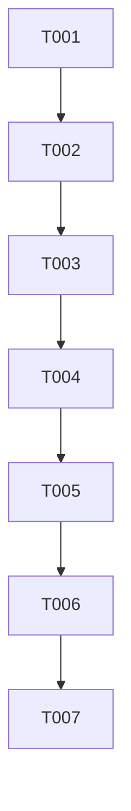

# Tasks: 第六批精修（ui-refine-batch-5）

**Input**: Design documents from `spec/ui-refine-batch-5/`
**Prerequisites**: plan.md (required), spec.md (required for user stories)

**Tests**: 无独立测试任务；验证走 Verification 阶段（build + 部署 + dumpLayout 布局断言 + 逐条 UI 验收）。

**Organization**: 按用户故事分组，2 个故事对应 2 项需求；同文件任务串行。

## Format: `[ID] [P?] [Story] Description`

- **[P]**: 可并行（不同文件、无依赖）
- **[Story]**: 所属用户故事（US1-US2）
- 描述含精确文件路径

## Path Conventions

- 既有单工程：`entry\src\main\ets\`（源码）
- 所有路径相对 `C:\Users\13775\OctopLink\`

---

## Phase 1: Setup

**Purpose**: 上下文确认（既有工程，无脚手架需求）

- [X] T001 确认 MessageBubble.ets 助手气泡现状行号：操作行 Row（约 L429，含 L494 `.width('100%')` 与 L495 `.margin({ top: 11 })`）、气泡 Column 属性段（约 L498-504，含 L500 `.padding(14)` 与 L501 `.constraintSize({ maxWidth: '84%' })`）；确认 msg.usageIn/usageOut 与 streaming 字段可访问

**Checkpoint**: 现状与行号明确

---

## Phase 2: Foundational

无阻塞前置任务——2 个故事同文件先后修改，共享结构已存在。

**Checkpoint**: 直接进入用户故事

---

## Phase 3: User Story 1 - token 用量收回气泡内 (Priority: P1) 🎯 MVP

**Goal**: 操作行随气泡实际宽度拉伸（stretch），窄气泡用量不溢出、宽气泡靠右平齐保持

**Independent Test**: 短回复窄气泡的 ↑↓ 用量在气泡背景内（dumpLayout 断言用量 Text bounds ⊆ 气泡 Column bounds）；长回复宽气泡用量仍与按钮同行靠右

### Implementation for User Story 1

- [X] T002 [US1] 在 `entry\src\main\ets\components\MessageBubble.ets`：①操作行 Row（约 L494）`.width('100%')` 替换为 `.alignSelf(ItemAlign.Stretch)`（space 6、三按钮、Blank、用量 Text 全部不动）；②MessageBubble struct 新增私有方法 `bubbleMinWidth(): number`——`this.msg.streaming` 返回 0；否则 `this.msg.usageIn > 0 || this.msg.usageOut > 0` 返回 200，否则 120；③气泡 Column（约 L501）`.constraintSize({ maxWidth: '84%' })` 改为 `.constraintSize({ maxWidth: '84%', minWidth: this.bubbleMinWidth() })`

**Checkpoint**: US1 完成——用量始终在气泡内

---

## Phase 4: User Story 2 - 按钮上下间距缩窄 50% (Priority: P2)

**Goal**: 操作行与上方文本间距 11→6、与气泡底边间距 14→7

**Independent Test**: 按钮上方间距约 6vp、下方约 7vp（各缩 50%）；按钮功能正常

### Implementation for User Story 2

- [X] T003 [US2] 在 `entry\src\main\ets\components\MessageBubble.ets`（T002 后同文件串行）：①操作行 Row `.margin({ top: 11 })`（约 L495）改为 `.margin({ top: 6 })`；②气泡 Column `.padding(14)`（约 L500）改为 `.padding({ left: 14, right: 14, top: 14, bottom: 7 })`；③左右/顶部 padding、用户气泡分支、按钮尺寸 24/14 全部不动

**Checkpoint**: US2 完成——气泡更紧凑

---

## Phase 5: Polish & Cross-Cutting Concerns

**Purpose**: 回归保障

- [X] T004 回归自查：①用户气泡（右侧蓝底）布局未动；②思考折叠/工具调用卡/附件/排队撤回/错误重试未动；③复制/朗读三态/重试交互代码逐行未改；④对 MessageBubble.ets 跑 `arkts_check` 直至干净

---

## Phase 6: Verification

<!-- verification_scope: build+ui -->

**Purpose**: 构建、部署模拟器、逐条验收 2 项需求

- [x] T005 Build project and fix any compilation errors（invoke `devecocli build`，workdir=`C:\Users\13775\OctopLink`；iterate fix → build until success）
- [x] T006 Deploy application to emulator（invoke `devecocli run --skip-build --device 127.0.0.1:5555`）
- [x] T007 Run UI verification against deployed application：逐条验收 2 项——①打开含短回复（窄气泡）与带用量长回复的对话：dumpLayout 断言窄气泡场景 ↑↓ 用量 Text bounds 完全落在气泡 Column bounds 内（不溢出气泡背景），宽气泡场景用量仍靠右与三按钮同行垂直居中（中心 y 偏差 ≤1px），无用量消息右侧不占位；②按钮与上方文本间距约 6vp、与气泡底边约 7vp（对照截图各缩 50%），复制（"已复制" toast）/朗读三态/重试功能正常。工具链：`hdc -t 127.0.0.1:5555 shell uinput -T -c <x> <y>` 点击、`uitest dumpLayout`（UTF8 读取）、`snapshot_display`（仅 .jpeg，转 PNG 放 `C:\Users\13775\OctopLink\.cache.screens\` 供 VLM recognize_ui_components）、`hdc shell hilog -x` 日志验证

---

## Dependencies & Execution Order

### Phase Dependencies

- **Setup (Phase 1)**: T001 先行
- **User Stories (Phase 3-4)**: 同文件串行：T002→T003
- **Polish (Phase 5)**: 依赖 T002/T003
- **Verification (Phase 6)**: 依赖 T004

### 📊 Dependency Graph



### ⚡ Parallel Execution Guide

| Phase | Tasks | Required Files | Execution Notes |
|-------|-------|----------------|-----------------|
| US1 | T002 | components/MessageBubble.ets | 先修溢出 |
| US2 | T003 | components/MessageBubble.ets | T002 后串行 |

## Implementation Strategy

1. T001 Setup → T002（stretch + minWidth）→ T003（间距减半）
2. T004 Polish 自查 + arkts_check
3. T005-T007 Verification：build→部署模拟器→dumpLayout 断言用量在气泡内 + 截图验收间距减半
4. 验收标准：2/2 通过；第五批"平齐+靠右"效果在宽气泡场景保持

## Summary Report

- **Total tasks**: 7（Setup 1 / Stories 2 / Polish 1 / Verification 3）
- **Per-story count**: US1:1、US2:1
- **Parallel opportunities**: 无（单文件串行）
- **Independent test criteria**: 每个故事均有独立验证方式（见各 Phase Independent Test）
- **MVP scope**: US1（用量溢出修复）为 P1 核心

---

## Parallel Example: User Story 1→2

```text
# 单文件串行执行：
Task T002: "操作行 stretch + 气泡条件 minWidth" (components/MessageBubble.ets)
Task T003: "margin 11→6、底 padding 14→7" (components/MessageBubble.ets, 依赖 T002)

# 无其他文件组，US2 完成后直接进入 Polish（T004）
```

---

## Notes

- [P] 任务 = 不同文件、无依赖（本批无并行任务）
- [Story] 标签将任务映射到 spec.md 用户故事，保证可追溯
- 同文件多任务必须按 ID 顺序串行（T002→T003）
- 写/改 .ets 前必须加载 hmos-arkui-develop-skill；禁止裸对象字面量传参、any/unknown、as 断言（arkts 严格模式）
- 服务器端零改动；部署验证一律推模拟器（127.0.0.1:5555），真机（192.168.3.190:44541）仅在用户明确要求时推送
- minWidth 档位依据：三按钮 72 + Row space 6×5 + 用量 Text（fontSize 10 含 6 位数字余量）+ 气泡 padding 28 → 带用量 200 / 无用量 120 / 流式 0
- 完成每个任务后按一次交付，Verification 后统一验收
