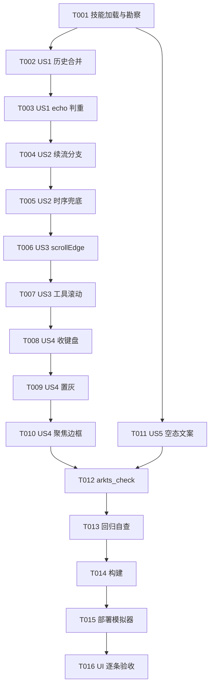

# Tasks: 聊天核心缺陷修复与交互改造（第七批）

**Input**: Design documents from `spec/ui-refine-batch-6/`
**Prerequisites**: plan.md (required), spec.md (required for user stories)

**Tests**: 未显式要求测试任务，不含测试 phase；验收以构建 + 模拟器部署 + UI 逐条验收进行。

**Organization**: 任务按用户故事分组（US1 竞态修复 / US2 重启续流 / US3 滚动修复 / US4 发送交互 / US5 空态文案），支持独立实现与验收。

## Format: `[ID] [P?] [Story] Description`

- **[P]**: 可并行（不同文件、无未完成依赖）
- **[Story]**: 所属用户故事（US1-US5）
- 描述含精确文件路径

## Path Conventions

- 项目根：`C:\Users\13775\OctopLink`
- 源码：`entry/src/main/ets/`（pages/chat、components、model、service、net）
- HAP 产物：`entry\build\default\outputs\default\entry-default-signed.hap`
- 构建：`devecocli build`（workdir=项目根）；部署：`devecocli run --skip-build --device 127.0.0.1:5555`
- 触控：`hdc -t 127.0.0.1:5555 shell uinput -T -c <x> <y>`；返回键 `uinput -K -d 2 -u 2`
- 布局检查：`uitest dumpLayout -p /data/local/tmp/x.json` + `hdc file recv`，读取必须 -Encoding UTF8
- 截屏：`hdc -t 127.0.0.1:5555 shell snapshot_display -f /data/local/tmp/x.jpeg`（仅 .jpeg）
- 日志：`hdc -t 127.0.0.1:5555 shell hilog -r` 清空 / `hilog -x` 导出，tag A00011/OctopLink

## Phase 1: Setup (Shared Infrastructure)

**Purpose**: 技能加载与改动面确认

- [X] T001 加载 hmos-arkui-develop-skill，通读 `entry/src/main/ets/pages/chat/ChatHomeTab.ets`（loadHistory L289-325、onUserEcho L610-623、onTurnStatus L654-673、scrollToBottom L811-821、ensureThread L824-853、send L856-918、输入区 L2495-2686、emptyStateBuilder L1711-1729）与 `entry/src/main/ets/components/WelcomeCard.ets`，确认改动点与现状一致

---

## Phase 2: User Story 1 - 竞态修复：消息不重复、流式不消失 (Priority: P1) 🎯 MVP

**Goal**: 历史加载返回与本地进行中消息合并；steer echo 判重。新会话发送/追问全流程消息恰好出现一次、流式增量持续可见。

**Independent Test**: 欢迎态发送第一条消息并连续追问 2-3 次，检查用户消息无重复、流式文本持续增长至完整。

- [X] T002 [US1] loadHistory 历史合并：`this.messages = result.messages` 替换改为合并——服务端消息为准，其后追加本地尚未落库的 fresh 用户消息（服务端结果尾部无同角色同文本者），`activeAssistant` 非 null 时追加回流式占位，保证流式增量写入可见气泡（`entry/src/main/ets/pages/chat/ChatHomeTab.ets` loadHistory 方法）
- [X] T003 [US1] onUserEcho steer echo 判重：push 用户消息前检查 `this.messages` 尾部是否已存在同文本用户消息，存在则跳过 push（仅保留流式占位创建逻辑）（`entry/src/main/ets/pages/chat/ChatHomeTab.ets` wireCallbacks 内 onUserEcho 回调）

**Checkpoint**: 新会话发送→流式→追问全流程消息无重复、流式不消失。

---

## Phase 3: User Story 2 - App 重启后活跃回合续流 (Priority: P1)

**Goal**: 订阅应答表明回合活跃且本地无流式气泡时重建气泡续流，回合结束以权威消息补齐；输入卡流光边框随流式状态恢复。

**Independent Test**: 发送长回复请求，流式中途杀掉 App 重启进入同一会话，观察流式气泡重建、增量继续、结束补齐完整。

- [X] T004 [US2] onTurnStatus 续流分支：`active===true` 且 `streaming===false` 且 `activeAssistant===null` 且 `hitlPending===null` 且 `hitlSubmitting===false` 时，创建流式占位 push 到 `this.messages` 尾部，置 `activeAssistant`/`streaming=true`/`streamPhase='恢复续流中…'`/`turnHadGap=true` 并滚动到底；后续帧经既有回调写入（回合结束因 turnHadGap 走既有 reconcileFinalMessage 补齐）（`entry/src/main/ets/pages/chat/ChatHomeTab.ets` wireCallbacks 内 onTurnStatus 回调）
- [X] T005 [US2] 续流时序兜底验收：确认"应答先于 loadHistory 返回"（占位被历史替换后经 T002 合并保留）与"晚于"（直接追加）两条时序均无空白气泡残留或气泡丢失；确认 `inputGlowOverlay`（InputFlowBorder）随 `streaming=true` 恢复挂载流动（`entry/src/main/ets/pages/chat/ChatHomeTab.ets`）

**Checkpoint**: 重启续流全链路可用，流光边框恢复旋转。

---

## Phase 4: User Story 3 - 滚动位置修复 (Priority: P1)

**Goal**: 所有滚动触发时机滚到列表真实底端，消除"跳到最近上一条"。

**Independent Test**: 长历史会话中发送消息触发带工具调用的回复，观察每次 badge/增量出现时视口底部均为最新内容。

- [X] T006 [US3] scrollToBottom 实现改为 `scroller.scrollEdge(Edge.Bottom)`（保留 force/150ms 节流与空列表守卫）；loadHistory 完成后的初始定位 `scrollToIndex(..., true)` 同步改为 `scrollEdge(Edge.Bottom)`（消除 spacer/加载更早项索引偏移）（`entry/src/main/ets/pages/chat/ChatHomeTab.ets` scrollToBottom 方法与 loadHistory 内 setTimeout 定位）
- [X] T007 [US3] onToolActivity 补充滚动：工具名 badge 变化时调用 `scrollToBottom(false)`，使"已调用"提示出现时列表滚到最新内容（`entry/src/main/ets/pages/chat/ChatHomeTab.ets` wireCallbacks 内 onToolActivity 回调）

**Checkpoint**: 发送/工具调用/文本增量/初始定位全部落在真实底部。

---

## Phase 5: User Story 4 - 发送交互：收键盘/置灰/聚焦边框 (Priority: P2)

**Goal**: 发送后清输入收键盘；空输入发送按钮置灰禁用；聚焦边框 2dp。

**Independent Test**: 空态查按钮置灰→输入变亮→发送后键盘收起输入清空按钮回置灰→聚焦边框 2dp 失焦 1dp。

- [X] T008 [US4] TextArea 挂 TextAreaController，`send()` 常规发送、slash 命令执行、`sendSteer()` 追问、`submitHitlRespond()` 人工回复四条成功路径调用 `stopEditing()` 收起软键盘（`entry/src/main/ets/pages/chat/ChatHomeTab.ets`）
- [X] T009 [US4] 空闲态发送按钮置灰：非流式且 `inputText.trim()===''` 时发送按钮呈置灰禁用态（`enabled(false)` + 降低前景/背景对比），有内容恢复现有品牌态；流式中停止/追问按钮行为不变（`entry/src/main/ets/pages/chat/ChatHomeTab.ets` 输入区发送按钮分支）
- [X] T010 [US4] 输入卡聚焦边框：新增 `@State inputFocused`，TextArea `onFocus`/`onBlur` 切换，输入卡 `.border({ width: inputFocused ? 2 : 1, color: card_stroke })`（`entry/src/main/ets/pages/chat/ChatHomeTab.ets` 输入卡 border 属性）

**Checkpoint**: 三项交互全部生效且不影响追问/审批按钮。

---

## Phase 6: User Story 5 - 新建会话空态文案替换 (Priority: P2)

**Goal**: 空态中间显示"开启一段新对话吧，什么都可以说。"，移除快捷提示 chips 图标群。

**Independent Test**: 点击新对话回欢迎态，检查文案与图标群移除。

- [X] T011 [P] [US5] WelcomeCard 空态改版：中间区域（logo 装饰块 + 快捷提示 chips Flex）替换为居中文案"开启一段新对话吧，什么都可以说。"（15fp、text_primary、居中、行高协调）；组件参数签名保留，欢迎语 message 渲染保留（`entry/src/main/ets/components/WelcomeCard.ets`）

**Checkpoint**: 空态文案逐字符合需求。

---

## Phase 7: Polish & Cross-Cutting Concerns

**Purpose**: 静态检查与回归确认

- [X] T012 对改动文件运行 arkts_check（`arkts_check --files ChatHomeTab.ets WelcomeCard.ets`），修复全部严格模式诊断（禁 any/裸对象字面量/解构；build() 顶层无局部声明；ForEach key 完整）（`entry/src/main/ets/pages/chat/ChatHomeTab.ets`、`entry/src/main/ets/components/WelcomeCard.ets`）
- [X] T013 回归自查：弱流恢复（断线重连/恢复续流提示/4 次失败标记中断）、HITL 审批流、steer 撤回、TTS、附件上传等既有路径未被本批改动破坏（`entry/src/main/ets/pages/chat/ChatHomeTab.ets`）

---

## Phase 8: Verification

<!-- verification_scope: build+ui -->

**Purpose**: 构建、部署模拟器、UI 逐条验收 7 项需求

- [X] T014 构建并修复编译错误（workdir=`C:\Users\13775\OctopLink` 执行 `devecocli build`；失败则修复后重建直至成功）
- [X] T015 部署到模拟器（`devecocli run --skip-build --device 127.0.0.1:5555`）
- [X] T016 UI 逐条验收（对已部署应用执行 7 项需求逐条验收：①新会话发送+追问消息无重复 ②流式不消失 ③流式中途杀 App 重启续流+流光恢复 ④空态文案逐字一致 ⑤发送后收键盘+空输入置灰+聚焦边框 2dp ⑥发送后滚到底最新可见 ⑦工具调用时滚到底不跳上一条；使用 uinput 触控/dumpLayout/snapshot_display/hilog 取证）

---

## Dependencies & Execution Order

### Phase Dependencies

- **Setup (Phase 1)**: 无依赖，立即开始
- **US1 (Phase 2)**: 依赖 T001；MVP 核心，阻塞 US2（续流气泡依赖 T002 合并兜底）
- **US2 (Phase 3)**: 依赖 T002-T003
- **US3 (Phase 4)**: 依赖 T005（同文件顺序编辑）
- **US4 (Phase 5)**: 依赖 T007（同文件顺序编辑）
- **US5 (Phase 6)**: 依赖 T001，可与 US1-US4 并行（不同文件）
- **Polish (Phase 7)**: 依赖全部实现任务
- **Verification (Phase 8)**: 依赖 T012-T013，串行构建→部署→验收

### User Story Dependencies

- **US1 (P1)**: 竞态合并是 US2 续流时序兜底的前置
- **US2 (P1)**: 依赖 US1；与 US3/US4/US5 无交叉
- **US3 (P1)**: 独立；滚动修正对 US1/US2 的滚动调用自动生效
- **US4 (P2)**: 独立；不触碰流式链路
- **US5 (P2)**: 完全独立（不同文件）

## 📊 Dependency Graph



## ⚡ Parallel Execution Guide

| Phase | Tasks | Required Files | Execution Notes |
|-------|-------|----------------|-----------------|
| US1-US4 | T002-T010 | ChatHomeTab.ets | 同文件顺序执行（T002→T010），避免编辑冲突 |
| US5 | T011 | WelcomeCard.ets | 可与 US1-US4 并行（不同文件） |
| Polish | T012-T013 | 两个改动文件 | 全部实现完成后统一执行 |
| Verification | T014-T016 | 构建产物/模拟器 | 串行：构建→部署→逐条验收 |

## Parallel Example

```bash
# 并行执行不同文件的任务（US5 与 US1 互不冲突）：
Task: "T002 [US1] loadHistory 历史合并 (ChatHomeTab.ets)"
Task: "T011 [P] [US5] WelcomeCard 空态文案替换 (WelcomeCard.ets)"

# 同文件任务必须串行（ChatHomeTab.ets 内）：
# T002 → T003 → T004 → T005 → T006 → T007 → T008 → T009 → T010
```

## Implementation Strategy

### MVP First (User Story 1 Only)

1. T001 Setup → 2. T002-T003 US1 → 3. 验证新会话无重复/不消失 → 4. 继续 US2/US3（P1 全量）→ US4/US5 → Polish → Verification

### Incremental Delivery

US1 竞态修复为 MVP 核心；US2 续流依赖 T002 合并兜底；US3/US4/US5 相互独立可增量交付。

## Notes

- [P] 任务 = 不同文件、无依赖（仅 T011）
- 全部改动限于客户端；服务器零改动
- State Management V1；ArkTS 严格模式约束全程生效
- 部署验证一律模拟器（127.0.0.1:5555）；真机部署仅用户明确要求
- 验收取证：dumpLayout 读取必须 -Encoding UTF8；截屏仅 .jpeg；hilog tag A00011/OctopLink
