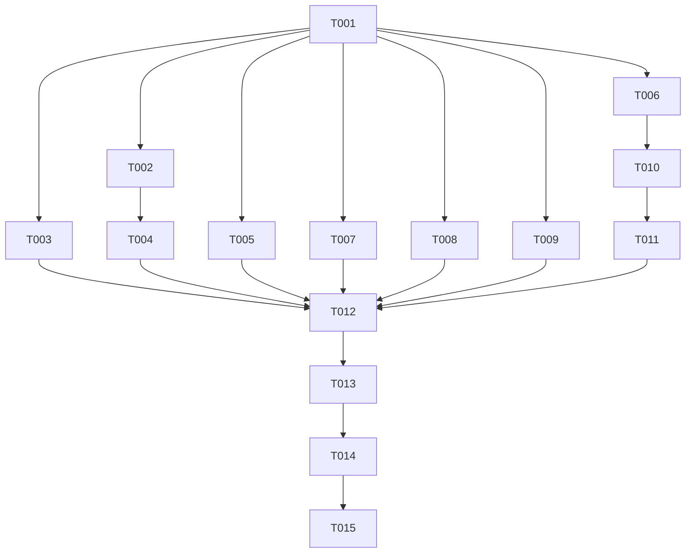

# Tasks: 移动端 UI 精修批次（UI Refine Batch）

**Input**: Design documents from `spec/ui-refine-batch/`
**Prerequisites**: plan.md (required), spec.md (required for user stories)

**Tests**: 未要求自动化测试；验证走构建+部署+逐条 UI 验收（build+ui，用户明确要求逐项验收）。

**Organization**: 任务按 User Story 分组（US1-US6），支持独立实现与独立验收。

## Format: `[ID] [P?] [Story] Description`

- **[P]**: 可并行（不同文件、无未完成依赖）
- **[Story]**: 所属 User Story（US1-US6）
- 描述含精确文件路径

## Path Conventions

- 项目根：`C:\Users\13775\OctopLink\`（既有 HarmonyOS 工程，entry 模块）
- ArkTS 源码：`entry/src/main/ets/`

---

## Phase 1: Setup (Shared Infrastructure)

**Purpose**: 既有工程增量精修，无脚手架需求；实现前置上下文准备。

- [x] T001 加载 hmos-arkui-develop-skill skill，精读 6 个目标文件与参考实现：`entry/src/main/ets/pages/chat/ChatHomeTab.ets`（工具行 2546-2701/深度思考 pill 2500-2528/上下文 pill 2637-2655）、`entry/src/main/ets/pages/expert/ExpertListPage.ets`（筛选行 345-372/列表 417-451/未用的 bottomPad prop）、`entry/src/main/ets/pages/workspace/SkillsPage.ets`（三弹窗 15-341）、`entry/src/main/ets/pages/workspace/PluginPage.ets`（三 sheet 559-791/主体 287-557）、`entry/src/main/ets/pages/workspace/MemoryPage.ets`（迁移入口 163-182/296）、`entry/src/main/ets/pages/workspace/ChannelPage.ets`（扫码 304-394/641-703/双卡 480-565/头像 212-234、749-758）；参考实现：`entry/src/main/ets/pages/me/MeTab.ets` avatarFullUrl(61-72)（QR URL 拼接模式）、`entry/src/main/ets/pages/MainPage.ets` contentBottomPad(63-66)（bottomPad 语义）、`entry/src/main/ets/components/UiMaterialKit.ets`（材质常量）；并查证 hds 组件声明中是否已有分段胶囊组件（有则复用、无则按 plan R2 自绘）

---

## Phase 2: Foundational (Blocking Prerequisites)

**Purpose**: US2 依赖的滑动胶囊控件。

- [x] T002 新建 `entry/src/main/ets/components/CapsuleSegmentBar.ets`（依赖 T001 查证结论；若 hds 已有等价组件则改为封装该组件）：V1 @Component 滑动胶囊分段控件——胶囊容器（glassBg+card_stroke 描边+padding 3）、等分段 Row、选中段 brand 滑块 translate 动画（animateTo 220ms easeOut）；接口 options（label/value）+ selectedIndex + onSelect(index)；高度 36-40，支持 2-5 段

**Checkpoint**: 滑动胶囊控件就绪。

---

## Phase 3: User Story 1 - 输入气泡设置层紧凑化与上下文数字右置 (Priority: P1) 🎯

**Goal**: 工具行与深度思考 pill 紧凑收窄；上下文百分比 pill 锚定发送按钮左侧不漂移。

**Independent Test**: 聊天页键盘态截图——工具行紧凑、上下文 % pill 紧贴发送按钮左侧；附件/润色/麦克风/模型/发送/上下文详情全部可用。

- [x] T003 [P] [US1] 修改 `entry/src/main/ets/pages/chat/ChatHomeTab.ets`：工具行圆形按钮 38→34、Row space 8→6、模型 pill 高 34→30（padding/maxWidth 90→72 收紧）、深度思考 pill 高 30→28；上下文 pill 与发送按钮间距 ≤6vp 并加 minWidth 防挤压（保持 Blank() 后、发送按钮前位置与 contextBarColor 三态、contextSheet 点击不变）；发送/停止按钮与全部 onClick 逻辑、流光 overlay、onAreaChange 量尺寸链路不变

**Checkpoint**: US1 独立可验收。

---

## Phase 4: User Story 2 - 专家页滑动胶囊与底部遮挡修复 (Priority: P1) 🎯

**Goal**: 筛选行改滑动胶囊；滚动到底最后一张卡片完整停在悬浮导航栏上方。

**Independent Test**: 专家页点击各筛选段——滑块平滑滑动、过滤正确；滚到底——最后卡片完整可见可点。

- [x] T004 [US2] 修改 `entry/src/main/ets/pages/expert/ExpertListPage.ets`（依赖 T002）：searchFilterBuilder 非搜索态 chips Row → CapsuleSegmentBar（options=filterOptions()，选中回调复用现有 filterIndex 切换+load()）；搜索态 TextInput、下拉刷新、agentCard、长按菜单不变
- [x] T005 [P] [US2] 修改 `entry/src/main/ets/pages/expert/ExpertListPage.ets`：List 尾部新增占位 `ListItem().height(this.bottomPad).hitTestBehavior(HitTestMode.None)`（bottomPad 已由 MainPage 传入，当前未使用；与顶部 150 占位项 422-425 同构）；List padding bottom 保持 0

**Checkpoint**: US2 独立可验收（T004/T005 同文件顺序执行）。

---

## Phase 5: User Story 3 - 扫码接入二维码修复 (Priority: P1) 🎯

**Goal**: 二维码 URL 正确拼接加载；失败有明确态与重试；不再无限转圈。

**Independent Test**: 渠道页 → 接入渠道 → 扫码接入：服务器返回 qrcode_url 时码可见；失败显示失败态+重试。

- [x] T006 [P] [US3] 修改 `entry/src/main/ets/pages/workspace/ChannelPage.ets`：新增私有派生方法 qrFullUrl()（完全按 MeTab.avatarFullUrl 61-72 模式：相对路径拼 baseUrl+鉴权参数）；qrSheetBuilder 改状态机 loading/loaded/failed——Image(qrFullUrl) 加 .onError(置 failed)、failed 态显示"二维码加载失败"+重试按钮（重新 startQr）、generate 抛错显示错误文案+重新生成入口、仅 token 无 url 显示验证码等待态；轮询 pollOnce/schedulePoll 逻辑与周期不变；startQr/generateSession/平台分发不变

**Checkpoint**: US3 独立可验收（扫码链路不再静默失败）。

---

## Phase 6: User Story 4 - 技能与插件弹窗/页面布局优化 (Priority: P2)

**Goal**: 技能三弹窗、插件三 sheet 与插件页主体版式统一（plan R5 标准）。

**Independent Test**: 打开各弹窗/sheet 截图核对版式统一、内容可滚动、按钮可达；功能操作正常。

- [x] T007 [P] [US4] 修改 `entry/src/main/ets/pages/workspace/SkillsPage.ets`：SkillCreateDialog/SkillEditDialog/SkillImportDialog 按 R5 版式标准重排（标题 16-17 Medium、内容 Scroll+maxHeight、TextInput 高 40-44/TextArea minHeight 96、开关行高 44-48、按钮行主按钮 40 高右对齐、间距节奏统一）；SkillService.create/update/importSkill 提交逻辑与 FAB/添加菜单/hub 安装不变
- [x] T008 [P] [US4] 修改 `entry/src/main/ets/pages/workspace/PluginPage.ets`：marketBuilder/urlBuilder/toolsBuilder 三 sheet 按 R5 标准重排；主体"全局插件/此专家插件"分区标题、列表行、Toggle、长按卸载布局优化；GlobalPluginService/PluginService 调用、confirmForceInstall/confirmUninstall 流程不变

**Checkpoint**: US4 独立可验收（T007/T008 不同文件可并行）。

---

## Phase 7: User Story 5 - 记忆迁移与接入渠道弹窗布局优化 (Priority: P2)

**Goal**: 记忆迁移 ActionSheet 升级为双选项弹窗；接入渠道双卡布局优化。

**Independent Test**: 记忆页迁移按钮 → 新弹窗两选项可达；渠道页 + → 双卡布局整齐两入口可达。

- [x] T009 [P] [US5] 修改 `entry/src/main/ets/pages/workspace/MemoryPage.ets`：showPortMenu 的 ActionSheet → bindSheet('port') 半模态——标题"记忆迁移"+副题"导出或导入 .hmpkg 记忆包"+两选项行（square_and_arrow_up 导出记忆包 / square_and_arrow_down 导入记忆包，图标+标题+说明+整行可点），点击分别调既有 exportPackage()/importPackage()；MemoryService.pack/adopt、DocumentViewPicker 流程、MemoryAtomEditDialog/MemoryPrefsDialog 不变
- [x] T010 [US5] 修改 `entry/src/main/ets/pages/workspace/ChannelPage.ets`（依赖 T006 同文件顺序执行）：accessModeBuilder 双卡（创建渠道/扫码接入）布局优化——图标尺寸、标题、副题、间距、整卡可点区域；openCreateSheet 与 sheetMode='qr' 分发不变

**Checkpoint**: US5 独立可验收。

---

## Phase 8: User Story 6 - 渠道头像美化 (Priority: P2)

**Goal**: 渠道列表头像从纯色字母升级为品牌色渐变精致样式。

**Independent Test**: 渠道列表截图核对渐变样式、平台色区分、未知类型回退、禁用态半透明。

- [x] T011 [US6] 修改 `entry/src/main/ets/pages/workspace/ChannelPage.ets`（依赖 T010 同文件顺序执行）：platformBadge 映射扩展为 {label, mainColor, lightColor}（dingtalk #1677FF→#69B4FF、wecom #00B96B→#67E0A8、qq #12B7F5→#7ADCFF、weixin #07C160→#6BDD9B、feishu #3370FF→#8AA8FF、yuanbao #FF7D00→#FFB366、未知 #7F7F7F→#B2B2B2）；头像渲染改线性渐变（RightBottom）+内高光细描边+字母 18fp Bold 白字；44×44 radius 14、禁用 opacity 0.5、列表项长按菜单/启停/删除不变

**Checkpoint**: US6 独立可验收。

---

## Phase 9: Polish & Cross-Cutting Concerns

**Purpose**: 规范收口与回归自查。

- [x] T012 全量 ArkTS 规范收口与回归自查（依赖 T003-T011）：新增/修改文件无未用导入、无 any、ForEach 带 key、V1 装饰器不混 V2、日志走 utils/Logger；对照 spec FR-012 逐项自查功能回归面（附件/润色/麦克风/模型选择/发送/上下文详情/专家筛选搜索/技能创建导入/插件安装启停卸载/记忆导出导入/渠道创建扫码测试启停删除）

---

## Phase 10: Verification

<!-- verification_scope: build+ui -->

**Purpose**: 构建、部署与逐条 UI 验收（用户要求逐项验收 9 项：① 工具行紧凑 ② 上下文 pill 右置 ③ 滑动胶囊 ④ 专家页底部遮挡 ⑤ 扫码二维码 ⑥ 技能弹窗 ⑦ 插件 sheet/页面 ⑧ 记忆迁移+接入渠道双卡 ⑨ 渠道头像）。

- [x] T013 运行 arkts_check 后执行 `devecocli build` 并修复编译错误（iterate 修复→重建直至成功）
- [x] T014 部署应用到模拟器（127.0.0.1:5555）：`devecocli run --skip-build`
- [x] T015 按 User Story 逐条 UI 验收（每 Story 截图核对 + 交互验证）：US1 聊天页键盘态工具行与上下文 pill 位置；US2 专家页滑动胶囊切换与滚动到底无遮挡；US3 渠道扫码 sheet 失败态/重试；US4 技能弹窗与插件 sheet/页面版式；US5 记忆迁移弹窗与接入渠道双卡；US6 渠道头像渐变。每 Story 最多 3 次验证（初验+2 轮修复复验），全部通过后执行最终全量复验（不再修复）

---

## Dependencies & Execution Order

### 任务依赖图



### Phase 依赖

- **Setup (T001)**: 无依赖，先行
- **Foundational (T002)**: 仅 US2 的 T004 依赖；不阻塞其他 Story
- **US1/US3/US4/US5/US6**: 均仅依赖 T001，可并行启动
- **同文件串行组**: ExpertListPage（T004→T005）、ChannelPage（T006→T010→T011）
- **Polish (T012)**: 依赖全部实现任务
- **Verification (T013→T014→T015)**: 严格串行殿后

## ⚡ Parallel Execution Guide

| Phase | Tasks | Required Files | Execution Notes |
|-------|-------|----------------|-----------------|
| Setup | T001 | 6 目标文件+3 参考实现 | 单任务，先行 |
| 并行组 A | T003 ∥ T006 ∥ T007 ∥ T008 ∥ T009 | ChatHomeTab / ChannelPage / SkillsPage / PluginPage / MemoryPage | 不同文件可并行；T004/T005 需 T002 后入组 |
| 串行组 | T004 → T005 | ExpertListPage | 同文件顺序执行 |
| 串行组 | T006 → T010 → T011 | ChannelPage | 同文件顺序执行 |
| Polish | T012 | 全部 | 依赖实现完成 |
| Verification | T013 → T014 → T015 | 构建产物+模拟器 | 严格串行 |

## Parallel Example

```text
# 并行组 A（不同文件、均仅依赖 T001）：
Task: T003 [US1] ChatHomeTab 工具行紧凑化
Task: T006 [US3] ChannelPage 二维码修复
Task: T007 [US4] SkillsPage 弹窗版式统一
Task: T008 [US4] PluginPage sheet/主体优化
Task: T009 [US5] MemoryPage 迁移弹窗
```

## Implementation Strategy

### MVP First（三个 P1 Story 先行）

1. T001 → T002（胶囊控件）
2. T003（US1）∥ T004+T005（US2）∥ T006（US3）→ **STOP 验收 P1**
3. T007-T011（P2）→ T012 → T013 → T014 → T015

### Incremental Delivery

每个 Story Checkpoint 均可独立截图验收；同文件串行组内保持顺序避免冲突。

## Notes

- [P] 任务 = 不同文件且无未完成依赖；同文件任务必须串行（ExpertListPage、ChannelPage 两组）
- message-tts 批次文件（MessageBubble 朗读链路/VoiceSettingsPage/LocalTtsService/AppPrefs/LocalTtsConfigDialog）本批次不触碰
- FR-013（移动端设置模型 API 确认）为调研结论，无需实现任务，验收时在报告中作答
- 模拟器（127.0.0.1:5555）为唯一自动化验证目标；扫码二维码能否出码取决于服务器返回，验收重点为 URL 拼接与失败态/重试
- 服务器端零改动；全部 API 调用原样保留
